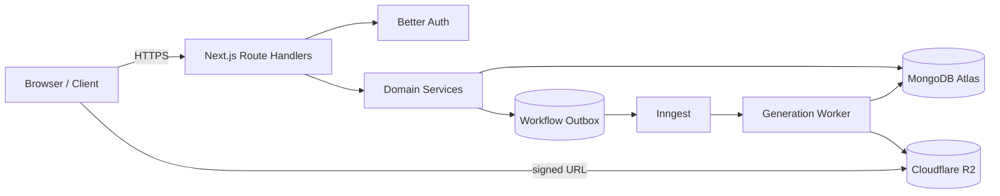
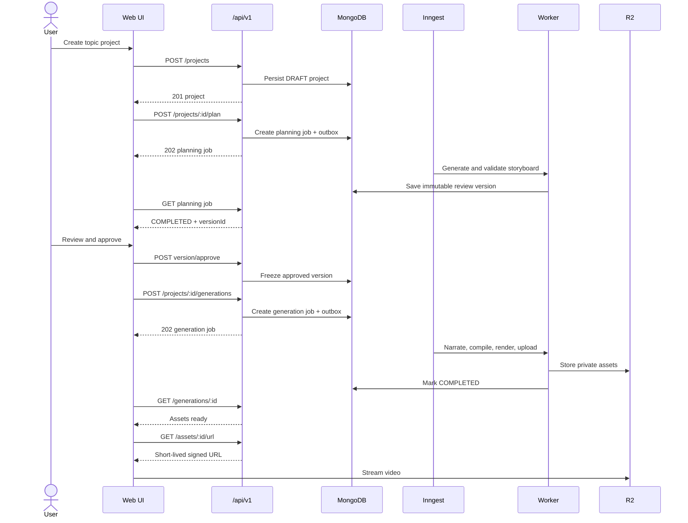

# Motionly AI — API Design

**Status:** V1 implementation specification  
**Last reviewed:** 2026-11-10  
**Base path:** `/api/v1`  
**Transport:** HTTPS + JSON; Server-Sent Events for live progress  
**Companion documents:** [System Design](./SYSTEM_DESIGN.md), [System Architecture](./SYSTEM_ARCHITECTURE.md), [Database Design](./DATABASE_DESIGN.md)

## 1. Purpose

This document defines Motionly AI's V1 HTTP API. It covers authentication boundaries, resource contracts, endpoint behavior, validation, asynchronous workflows, errors, idempotency, pagination, concurrency, safety limits, and observability.

V1 intentionally has no billing, subscriptions, payments, or customer-credit APIs.

## 2. Design principles

1. **Resource-oriented:** URLs represent projects, immutable versions, generation jobs, and assets.
2. **Asynchronous for expensive work:** planning, narration, and rendering return `202 Accepted` with a job identifier.
3. **Review before generation:** only an approved immutable version can start narration/rendering.
4. **Tenant-safe by construction:** every resource lookup is scoped by the authenticated user.
5. **Idempotent mutations:** expensive or retry-prone operations require `Idempotency-Key`.
6. **Strict contracts:** request and response payloads use shared Zod schemas.
7. **Stable public API:** internal provider details never leak into public contracts.
8. **No model-generated code:** the API accepts and returns structured content data only.
9. **Observable:** every response carries a request ID; every async job exposes durable progress.
10. **Forward-compatible:** additive fields are allowed; breaking changes require a new API version.

## 3. API boundaries



The public API never directly executes a full render. It validates intent, persists state, and schedules durable work.

## 4. Protocol conventions

### 4.1 Content types

- Requests and normal responses: `application/json; charset=utf-8`
- Errors: `application/problem+json`
- Progress stream: `text/event-stream`
- Media is delivered from object storage through signed URLs, not proxied through the API.

### 4.2 Identifiers

- Public resource IDs are canonical 24-character lowercase MongoDB ObjectId strings.
- IDs are opaque to clients; clients must not infer ownership or chronology from them.
- Invalid ID syntax returns `400 INVALID_ID` before querying the database.

### 4.3 Dates and numbers

- All timestamps are ISO 8601 UTC strings, for example `2026-11-09T05:45:00.000Z`.
- Durations use integer milliseconds in API metadata and seconds only in human-facing configuration.
- Frame counts, dimensions, FPS, attempts, and progress are integers.
- Monetary values do not exist in the V1 API.

### 4.4 Request headers

| Header                           | Required                    | Purpose                                               |
| -------------------------------- | --------------------------- | ----------------------------------------------------- |
| `Content-Type: application/json` | For JSON bodies             | Payload format                                        |
| `Idempotency-Key`                | Expensive `POST` operations | Safe retries; 8–128 printable characters              |
| `If-Match`                       | Revision-sensitive updates  | Optimistic concurrency                                |
| `X-Request-Id`                   | Optional                    | Client correlation ID; server generates one if absent |
| `Last-Event-ID`                  | Optional for SSE            | Resume progress events                                |

### 4.5 Response headers

| Header                | Purpose                                              |
| --------------------- | ---------------------------------------------------- |
| `X-Request-Id`        | End-to-end correlation                               |
| `ETag`                | Current mutable-resource version                     |
| `Location`            | URI of a newly created resource/job                  |
| `Retry-After`         | Retry guidance for `429` or temporary unavailability |
| `RateLimit-Limit`     | Current safety-limit window size where applicable    |
| `RateLimit-Remaining` | Remaining operations in the current window           |
| `RateLimit-Reset`     | UTC epoch seconds for reset                          |

## 5. Authentication and authorization

### 5.1 Authentication

Better Auth owns `/api/auth/*`; those endpoints are not part of `/api/v1`.

Initial V1 authentication:

- Public email/password registration with mandatory email verification.
- Resend delivery for verification and password-reset links.
- Secure, HTTP-only, same-site session cookie.
- Single-use password-reset tokens and session revocation after a successful reset.

### 5.2 Authorization

Every application request resolves the session and derives `ownerId` server-side. Client-supplied owner IDs are ignored or rejected.

Repository calls follow this pattern:

```ts
findProject({ _id: projectId, ownerId: session.user.id });
```

Behavior:

- Missing or invalid session: `401 UNAUTHENTICATED`.
- Authenticated user requesting another user's resource: `404 RESOURCE_NOT_FOUND`, preventing existence disclosure.
- Disabled/deleting account: `403 ACCOUNT_UNAVAILABLE`.
- Admin operations use separate internal routes and explicit audit-logged roles; they are not included in V1 public endpoints.

## 6. Standard response formats

### 6.1 Success envelope

```json
{
  "data": {
    "id": "690f15ee3a3db08ddad6e21a"
  },
  "meta": {
    "requestId": "req_01K9KX8X2P6N2H6WJRA7R28S32"
  }
}
```

`204 No Content` responses have no body.

### 6.2 Collection envelope

```json
{
  "data": [],
  "meta": {
    "requestId": "req_01K9KX8X2P6N2H6WJRA7R28S32",
    "page": {
      "nextCursor": null,
      "hasMore": false,
      "limit": 20
    }
  }
}
```

### 6.3 Error format

Errors follow RFC 9457-style problem details with stable Motionly extensions.

```json
{
  "type": "https://motionly.ai/problems/validation-failed",
  "title": "Request validation failed",
  "status": 422,
  "code": "VALIDATION_FAILED",
  "detail": "One or more fields are invalid.",
  "instance": "/api/v1/projects",
  "requestId": "req_01K9KX8X2P6N2H6WJRA7R28S32",
  "errors": [
    {
      "path": "topic",
      "code": "too_small",
      "message": "Topic must contain at least 3 characters."
    }
  ]
}
```

Public errors never include stack traces, provider keys, signed URLs, raw provider bodies, database queries, or private resource details.

## 7. HTTP status policy

| Status                      | Usage                                                            |
| --------------------------- | ---------------------------------------------------------------- |
| `200 OK`                    | Successful read or action with an immediate result               |
| `201 Created`               | Synchronously created project/version                            |
| `202 Accepted`              | Planning, generation, retry, cancellation, or deletion scheduled |
| `204 No Content`            | Successful update without response body                          |
| `304 Not Modified`          | Conditional `GET` matched ETag                                   |
| `400 Bad Request`           | Malformed JSON, invalid ID, cursor, or header                    |
| `401 Unauthorized`          | No valid session                                                 |
| `403 Forbidden`             | Account unavailable or operation prohibited by state             |
| `404 Not Found`             | Resource absent or not owned by requester                        |
| `409 Conflict`              | State conflict, duplicate operation, or stale revision           |
| `412 Precondition Failed`   | `If-Match` does not match current mutable resource               |
| `422 Unprocessable Content` | Structurally valid JSON that fails business validation           |
| `429 Too Many Requests`     | Configured safety limit reached                                  |
| `500 Internal Server Error` | Unexpected server defect                                         |
| `502 Bad Gateway`           | Upstream provider returned an invalid response                   |
| `503 Service Unavailable`   | Temporary provider/worker/queue unavailability                   |

## 8. Error codes

### Request and auth

- `INVALID_JSON`
- `INVALID_ID`
- `INVALID_CURSOR`
- `VALIDATION_FAILED`
- `UNAUTHENTICATED`
- `ACCOUNT_UNAVAILABLE`
- `RESOURCE_NOT_FOUND`
- `IDEMPOTENCY_KEY_REQUIRED`
- `IDEMPOTENCY_KEY_REUSED`
- `PRECONDITION_FAILED`

### Project and revision

- `PROJECT_STATE_CONFLICT`
- `VERSION_NOT_APPROVABLE`
- `VERSION_ALREADY_APPROVED`
- `SCRIPT_IMMUTABILITY_VIOLATION`
- `STORYBOARD_INVALID`
- `TEMPLATE_NOT_SUPPORTED`
- `TIMELINE_INVALID`

### Generation

- `GENERATION_LIMIT_REACHED`
- `GENERATION_ALREADY_ACTIVE`
- `GENERATION_NOT_RETRYABLE`
- `GENERATION_NOT_CANCELABLE`
- `PROVIDER_RATE_LIMITED`
- `PROVIDER_UNAVAILABLE`
- `PROVIDER_ACCOUNT_LIMIT`
- `RENDER_FAILED`
- `STORAGE_FAILED`

## 9. Pagination, filtering, and sorting

Collection endpoints use cursor pagination.

Query parameters:

- `limit`: default `20`, minimum `1`, maximum `100`.
- `cursor`: opaque base64url cursor issued by the server.
- Resource-specific filters such as `status` or `projectId`.

The cursor encodes the stable sort tuple, normally `{ updatedAt, _id }` or `{ createdAt, _id }`. Clients must treat it as opaque.

Example:

```http
GET /api/v1/projects?status=READY&limit=20&cursor=eyJ1cGRhdGVkQXQiOiIuLi4ifQ
```

Offset pagination is not supported because it becomes slow and inconsistent as records are inserted.

## 10. Idempotency

### 10.1 Required endpoints

`Idempotency-Key` is required for:

- `POST /projects/:id/plan`
- `POST /projects/:id/versions/:versionId/approve`
- `POST /projects/:id/generations`
- `POST /generations/:jobId/retry`
- `POST /generations/:jobId/cancel`
- `DELETE /projects/:id`

### 10.2 Behavior

The server stores a hash of method, normalized path, authenticated user, and canonical request body.

- Same key + same request: replay the original status, headers, and safe response body.
- Same key + different request: `409 IDEMPOTENCY_KEY_REUSED`.
- Processing still active: return the existing `202` response.
- Records expire after 24 hours unless the operation requires longer retention.

Provider calls also use stable internal operation keys derived from `jobId + step + contentHash`.

## 11. Optimistic concurrency

Mutable resources (`projects`) return an ETag:

```http
ETag: W/"project-7-20261109T054500000Z"
```

`PATCH` requests require `If-Match`. A stale tag returns `412 PRECONDITION_FAILED` with the current ETag.

Project versions are immutable. Editing creates a new revision instead of updating an existing version.

## 12. Resource models

### 12.1 Project summary

```json
{
  "id": "690f15ee3a3db08ddad6e21a",
  "title": "How Binary Search Works",
  "inputMode": "TOPIC",
  "topic": "How does binary search work?",
  "status": "READY",
  "currentVersionId": "690f16063a3db08ddad6e226",
  "latestGeneration": {
    "id": "690f16a53a3db08ddad6e262",
    "status": "COMPLETED",
    "progress": 100
  },
  "createdAt": "2026-11-09T05:30:00.000Z",
  "updatedAt": "2026-11-09T05:45:00.000Z"
}
```

### 12.2 Project status

```text
DRAFT
PLANNING
REVIEW_READY
APPROVED
GENERATING
READY
FAILED
ARCHIVED
DELETING
```

### 12.3 Generation status

```text
QUEUED
GENERATING_AUDIO
COMPILING_TIMELINE
RENDERING
UPLOADING
COMPLETED
FAILED
CANCEL_REQUESTED
CANCELED
```

### 12.4 Asset summary

```json
{
  "id": "690f17643a3db08ddad6e2b1",
  "type": "VIDEO",
  "mimeType": "video/mp4",
  "bytes": 2253859,
  "media": {
    "durationMs": 30000,
    "width": 720,
    "height": 1280,
    "fps": 30,
    "codec": "h264"
  },
  "createdAt": "2026-11-09T05:44:58.000Z"
}
```

## 13. Project endpoints

### 13.1 Create project

```http
POST /api/v1/projects
```

Topic-mode request:

```json
{
  "title": "How Binary Search Works",
  "inputMode": "TOPIC",
  "topic": "How does binary search work?",
  "video": {
    "width": 720,
    "height": 1280,
    "fps": 30,
    "targetDurationSeconds": 30,
    "style": "CLEAN_2D_EDUCATIONAL"
  }
}
```

Script-mode request:

```json
{
  "title": "Customer Script",
  "inputMode": "SCRIPT",
  "sourceScript": "The exact narration supplied by the user...",
  "video": {
    "width": 720,
    "height": 1280,
    "fps": 30,
    "targetDurationSeconds": 30,
    "style": "CLEAN_2D_EDUCATIONAL"
  }
}
```

Validation:

- Title: 1–120 characters.
- Topic: 3–500 characters in topic mode.
- Source script: 1–5,000 characters in script mode.
- Exactly one of `topic` or `sourceScript` is accepted according to `inputMode`.
- V1 output dimensions, FPS, and style are allowlisted values.

Response: `201 Created`, project in `DRAFT`, `Location: /api/v1/projects/:id`.

### 13.2 List projects

```http
GET /api/v1/projects?status=READY&limit=20&cursor=...
```

Default sort: `updatedAt DESC, _id DESC`.

Supported filters:

- `status`
- `inputMode`
- `archived=true|false`
- `q` for normalized title prefix/search implementation approved for V1

Responses use compact project summaries and never embed full storyboards.

### 13.3 Get project

```http
GET /api/v1/projects/:projectId
```

Query options:

- `include=currentVersion,latestGeneration,assets`

The response includes only requested expansions to avoid oversized payloads.

### 13.4 Update project metadata

```http
PATCH /api/v1/projects/:projectId
If-Match: W/"..."
```

```json
{
  "title": "Binary Search Explained",
  "archived": false
}
```

Only title and archive state are mutable. Input mode and approved content are changed through new project versions.

Response: `200 OK` with the updated project and new ETag.

### 13.5 Delete project

```http
DELETE /api/v1/projects/:projectId
Idempotency-Key: ...
```

Response: `202 Accepted` with a deletion-job identifier. The project immediately enters `DELETING`, becomes inaccessible to normal project queries, and is purged asynchronously from MongoDB and R2.

## 14. Planning and version endpoints

### 14.1 Start planning

```http
POST /api/v1/projects/:projectId/plan
Idempotency-Key: ...
```

```json
{
  "expectedProjectStatus": "DRAFT"
}
```

Behavior:

1. Validate project state and V1 safety limits.
2. Create a planning job.
3. Write an outbox event.
4. Return immediately.

Response: `202 Accepted`.

```json
{
  "data": {
    "jobId": "690f16213a3db08ddad6e23f",
    "type": "PLANNING",
    "status": "QUEUED",
    "statusUrl": "/api/v1/planning-jobs/690f16213a3db08ddad6e23f"
  },
  "meta": {
    "requestId": "req_..."
  }
}
```

### 14.2 Get planning job

```http
GET /api/v1/planning-jobs/:jobId
```

Planning statuses:

```text
QUEUED
GENERATING
VALIDATING
COMPLETED
FAILED
CANCELED
```

On completion the response contains `projectVersionId`.

### 14.3 List versions

```http
GET /api/v1/projects/:projectId/versions?limit=20&cursor=...
```

Sort: `revision DESC`.

### 14.4 Get version

```http
GET /api/v1/projects/:projectId/versions/:versionId
```

Returns source text, script, storyboard, validation summary, provenance, and approval state.

### 14.5 Create edited version

```http
POST /api/v1/projects/:projectId/versions
```

```json
{
  "basedOnVersionId": "690f16063a3db08ddad6e226",
  "script": "Reviewed narration...",
  "storyboard": {
    "schemaVersion": "0.1",
    "project": {},
    "video": {},
    "scenes": []
  }
}
```

Rules:

- `basedOnVersionId` must be the current version unless the client explicitly resolves a conflict.
- In script mode, narration must preserve the approved source script according to normalization rules.
- The storyboard is validated before persistence.
- A new sequential revision is created; the base revision remains unchanged.

Response: `201 Created`.

### 14.6 Approve version

```http
POST /api/v1/projects/:projectId/versions/:versionId/approve
Idempotency-Key: ...
```

```json
{
  "contentHash": "sha256:...",
  "confirmation": "APPROVE"
}
```

The supplied hash must match the server-computed normalized content hash, preventing approval of content different from what the user reviewed.

Response: `200 OK` with immutable approval metadata.

## 15. Generation endpoints

### 15.1 Start generation

```http
POST /api/v1/projects/:projectId/generations
Idempotency-Key: ...
```

```json
{
  "versionId": "690f16063a3db08ddad6e226",
  "output": {
    "format": "MP4",
    "codec": "H264"
  }
}
```

Admission checks:

- Version exists, belongs to the project/user, and is approved.
- No active generation already exists for the same version unless explicitly allowed.
- Concurrency, daily-generation, duration, provider-account, and storage safety limits pass.
- Template registry and schema versions remain renderable by the deployed worker.

Response: `202 Accepted`, with `Location: /api/v1/generations/:jobId`.

### 15.2 List project generations

```http
GET /api/v1/projects/:projectId/generations?status=COMPLETED&limit=20&cursor=...
```

Sort: `createdAt DESC, _id DESC`.

### 15.3 Get generation

```http
GET /api/v1/generations/:jobId
```

```json
{
  "data": {
    "id": "690f16a53a3db08ddad6e262",
    "projectId": "690f15ee3a3db08ddad6e21a",
    "versionId": "690f16063a3db08ddad6e226",
    "status": "RENDERING",
    "step": "render",
    "progress": 72,
    "attempt": 1,
    "cancelRequested": false,
    "error": null,
    "assets": [],
    "createdAt": "2026-11-09T05:40:00.000Z",
    "startedAt": "2026-11-09T05:40:02.000Z",
    "updatedAt": "2026-11-09T05:42:10.000Z"
  },
  "meta": {
    "requestId": "req_...",
    "pollAfterMs": 2000
  }
}
```

Progress is monotonic from 0 to 100 and derived from durable step/frame progress. Clients must rely on `status`, not infer completion from `progress` alone.

### 15.4 Stream generation events

```http
GET /api/v1/generations/:jobId/events
Accept: text/event-stream
```

Event example:

```text
id: 37
event: generation.progress
data: {"jobId":"...","status":"RENDERING","progress":72,"occurredAt":"..."}

```

Supported event types:

- `generation.status`
- `generation.progress`
- `generation.completed`
- `generation.failed`
- `generation.canceled`
- `heartbeat`

Clients reconnect with `Last-Event-ID`. Polling `GET /generations/:jobId` remains the mandatory fallback.

### 15.5 Retry generation

```http
POST /api/v1/generations/:jobId/retry
Idempotency-Key: ...
```

Allowed only for `FAILED` jobs whose approved version remains compatible. The server creates a new attempt/job record or increments an attempt according to the database contract; completed assets are never overwritten.

Response: `202 Accepted` with the retry job.

### 15.6 Cancel generation

```http
POST /api/v1/generations/:jobId/cancel
Idempotency-Key: ...
```

Cancellation is best effort. A job may finish if the provider/render step cannot be interrupted safely. The response describes whether cancellation was requested or the job was already terminal.

## 16. Asset endpoints

### 16.1 List job assets

```http
GET /api/v1/generations/:jobId/assets
```

Returns asset metadata only—never storage credentials or raw storage keys.

### 16.2 Get signed asset URL

```http
GET /api/v1/assets/:assetId/url?disposition=inline
```

Query parameters:

- `disposition`: `inline` or `attachment`.
- `ttlSeconds`: optional `60–600`; server may cap it.

```json
{
  "data": {
    "url": "https://signed-storage-url.example/...",
    "expiresAt": "2026-11-09T05:55:00.000Z",
    "disposition": "inline"
  },
  "meta": {
    "requestId": "req_..."
  }
}
```

The API verifies ownership before signing. Signed URLs must not be written to application logs.

## 17. Operational usage endpoint

```http
GET /api/v1/usage
```

This is operational information, not billing.

```json
{
  "data": {
    "window": {
      "startsAt": "2026-11-09T00:00:00.000Z",
      "endsAt": "2026-11-10T00:00:00.000Z"
    },
    "limits": {
      "dailyGenerations": 10,
      "concurrentGenerations": 1,
      "maxDurationSeconds": 90,
      "storageBytes": 1073741824
    },
    "used": {
      "generations": 2,
      "activeGenerations": 0,
      "storageBytes": 4495410
    }
  },
  "meta": {
    "requestId": "req_..."
  }
}
```

The UI may use this to explain a safety limit. Users cannot purchase or modify limits in V1.

## 18. Account endpoints

### 18.1 Get current profile

```http
GET /api/v1/me
```

Returns application profile fields and operational limits. Authentication identities/sessions remain managed by Better Auth.

### 18.2 Request account deletion

```http
DELETE /api/v1/me
Idempotency-Key: ...
```

Requires recent authentication or a Better Auth reauthentication flow. Returns `202 Accepted`; an auditable workflow removes projects, assets, sessions, and identity records.

## 19. Internal endpoints

### 19.1 Inngest endpoint

```http
POST /api/inngest
```

- Not part of `/api/v1`.
- Protected by Inngest signing verification.
- Does not accept browser authentication as sufficient authorization.
- Production errors are sanitized and traced.

### 19.2 Health endpoints

```http
GET /api/health/live
GET /api/health/ready
```

- `live`: process is running; no dependency calls.
- `ready`: verifies bounded, non-destructive connectivity to required dependencies.
- Responses expose no secrets, hostnames, cluster names, or provider-account details.

## 20. Rate and safety limiting

V1 limits protect infrastructure; they are not commercial entitlements.

Suggested initial defaults:

| Operation              | Limit                                |
| ---------------------- | ------------------------------------ |
| Project creation       | 30 per user per hour                 |
| Planning requests      | 10 per user per day                  |
| Generation requests    | 10 per user per day                  |
| Concurrent generations | 1 per user; 10 system-wide initially |
| Signed URL creation    | 120 per user per hour                |
| Project list/read      | 300 per user per 5 minutes           |
| Maximum source script  | 5,000 characters                     |
| Maximum video duration | 90 seconds                           |

Limits are configuration-driven and can be changed without altering API contracts.

## 21. Caching

- Authenticated project/job responses: `Cache-Control: private, no-store` by default.
- Conditional reads may use ETags to return `304` without a body.
- Signed URL responses: `private, no-store`.
- Static template/catalog metadata may be cached with explicit versioned keys.
- No CDN caching of tenant-specific JSON unless an ownership-safe design is proven.

## 22. Security requirements

1. Validate `Origin`/CSRF protections for cookie-authenticated mutations.
2. Apply strict body-size and content-type checks before parsing.
3. Never accept storage keys, provider IDs, job status, owner ID, or approval timestamps directly from clients as authoritative.
4. Verify resource ownership at every repository boundary.
5. Use allowlists for dimensions, duration, codec, style, model, voice, template, and action values.
6. Return signed asset URLs only after authorization; default TTL is 10 minutes.
7. Redact scripts and topics from telemetry where privacy settings require it.
8. Sanitize upstream errors and store detailed provider context only in protected operational fields.
9. Avoid arbitrary URL-fetch endpoints and server-side requests to client-provided hosts.
10. Audit project approval, generation start/retry/cancel, asset download, and deletion requests.

## 23. Observability

Every API span/log includes:

- `requestId`
- hashed or internal `userId`
- route template, method, status
- `projectId`, `versionId`, or `jobId` when present
- latency and response size
- idempotency replay indicator
- release SHA

Metrics:

- Request count, latency, and error rate per route.
- Validation failures by safe error code.
- Idempotency replays and conflicts.
- Safety-limit rejections.
- SSE connections/reconnects and polling volume.
- Queue admission latency.

## 24. Versioning and compatibility

- V1 routes live under `/api/v1`.
- Additive optional response fields do not require a new version.
- Removing/renaming fields, changing semantics, or narrowing accepted values requires `/api/v2` or a documented migration period.
- Enum expansion is treated as potentially breaking for exhaustive clients; clients must tolerate unknown enum values or use the shared SDK.
- Storyboard schema versioning is independent from HTTP API versioning.
- Deprecations include response headers and documentation with a removal date.

## 25. OpenAPI and generated client plan

The implementation should generate or maintain an OpenAPI 3.1 specification from the same Zod contracts used by Route Handlers.

Required CI checks:

- OpenAPI document generation is deterministic.
- Examples validate against schemas.
- No undocumented public route exists.
- Breaking API changes are detected against the main-branch specification.
- A typed browser client is generated or wrapped from the approved contract.

Target artifact:

```text
docs/openapi/motionly-v1.json
```

## 26. End-to-end flow



## 27. Implementation checklist

- [ ] Establish shared Zod request/response/error schemas.
- [ ] Add request ID middleware/helper.
- [ ] Add Better Auth session helper and ownership guard.
- [ ] Implement cursor codec and pagination tests.
- [ ] Implement idempotency repository and replay middleware.
- [ ] Implement ETag/`If-Match` support for projects.
- [ ] Implement project and immutable-version endpoints.
- [ ] Implement planning/generation admission plus workflow outbox.
- [ ] Implement polling and SSE progress APIs.
- [ ] Implement private asset metadata and signed URLs.
- [ ] Add safety-limit middleware/service.
- [ ] Generate OpenAPI 3.1 and validate examples in CI.
- [ ] Add route-level integration tests for auth, ownership, conflicts, and retries.

## 28. Authoritative references

- [Next.js Route Handlers](https://nextjs.org/docs/app/getting-started/route-handlers)
- [Better Auth installation](https://better-auth.com/docs/installation)
- [Inngest retries and error handling](https://www.inngest.com/docs/durable-execution/guides-and-advanced/error-handling)
- [Cloudflare R2 S3 API](https://developers.cloudflare.com/r2/get-started/s3/)
- [Gemini structured outputs](https://ai.google.dev/gemini-api/docs/structured-output)
- [ElevenLabs speech with timing](https://elevenlabs.io/docs/api-reference/text-to-speech/convert-with-timestamps)

## 29. Instagram publishing extension

The Instagram extension adds these authenticated `/api/v1` route groups:

- `/integrations/instagram/*` for OAuth start/callback, connection health, refresh, listing, and disconnect.
- `/projects/:projectId/publications` and `/publications/:publicationId/*` for publish now, one-time scheduling, history, retry, and cancellation.
- `/schedules` and `/schedules/:scheduleId/*` for create/update, activate, pause, run-now, run history, and archive.
- `/webhooks/meta` for verified Meta callbacks; this route is authenticated by Meta signature verification rather than a user session.

Every publication mutation uses an `Idempotency-Key`. Schedule updates use optimistic concurrency with `If-Match`. Manual publication requires approval of the selected completed video. `AUTO_PUBLISH` is accepted only after explicit schedule-level authorization and applies only to runs belonging to that schedule. Tokens and Meta credentials never appear in response resources.

The normative request fields, response states, errors, route table, and workflow contract are in [Instagram integration design](./INSTAGRAM_INTEGRATION_DESIGN.md).
