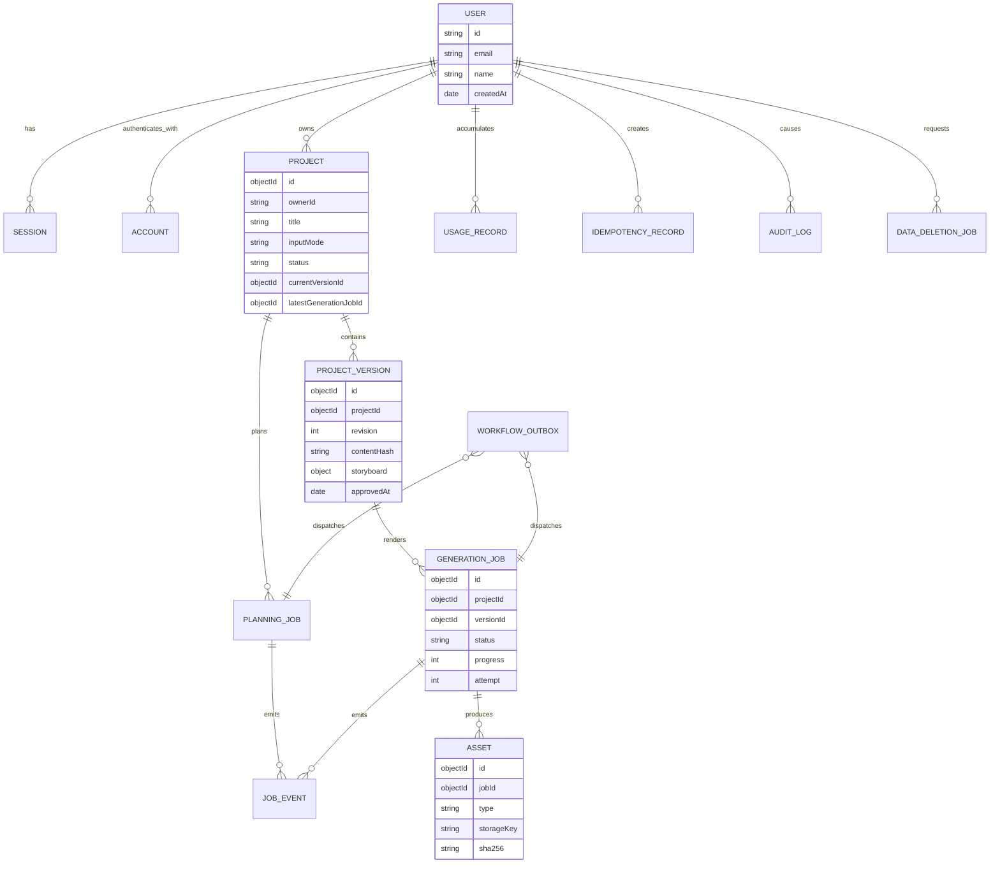

# Motionly AI — Database Design

**Status:** V1 implementation specification  
**Last reviewed:** 2026-11-10  
**Primary database:** MongoDB Atlas  
**Driver baseline:** Official MongoDB Node.js driver 7.8.0  
**Companion documents:** [System Design](./SYSTEM_DESIGN.md), [System Architecture](./SYSTEM_ARCHITECTURE.md), [API Design](./API_DESIGN.md)

## 1. Purpose

This document defines Motionly AI's V1 database model: collections, ownership boundaries, relationships, indexes, validation, transactions, idempotency, workflow outbox, retention, deletion, backups, and key access patterns.

MongoDB stores metadata and structured content. Large binary media—MP3, alignment exports, render props, previews, and MP4 files—lives in private object storage. MongoDB stores only asset metadata and storage keys.

V1 has no billing, subscriptions, payment, entitlement, or customer-credit collections.

## 2. Design principles

1. **Tenant ownership is explicit:** every application-owned document carries `ownerId` where practical.
2. **Approved content is immutable:** edits create a new `projectVersion`; approved versions are never updated in place.
3. **Jobs are durable records:** workflow state is persisted independently of worker process lifetime.
4. **Media stays out of MongoDB:** no MP4/audio blobs or base64 payloads in documents.
5. **Indexes follow access patterns:** every production query must be supported by a deliberate index.
6. **Bound document growth:** event histories and large outputs use separate collections.
7. **Idempotency is persistent:** API and workflow retries cannot create duplicate expensive work.
8. **Outbox protects event delivery:** database state and workflow intent are committed atomically.
9. **Transactions are narrow:** never keep a transaction open while calling Gemini, ElevenLabs, R2, or Remotion.
10. **Schema is versioned:** application Zod schemas are authoritative; MongoDB validators provide defense in depth.

## 3. Naming and type conventions

### 3.1 Collection names

Application collection names use lower camel case:

```text
projects
projectVersions
planningJobs
generationJobs
jobEvents
assets
usageRecords
socialConnections
publishingSchedules
scheduleRuns
publicationJobs
idempotencyRecords
workflowOutbox
auditLogs
dataDeletionJobs
```

Better Auth collection names are adapter-managed and finalized during integration. They are logically represented as `users`, `sessions`, `accounts`, and `verifications` in this document.

### 3.2 Field conventions

- Internal primary key: `_id: ObjectId`.
- Cross-collection references: `ObjectId`, except Better Auth user/session identifiers where its adapter contract uses strings.
- Tenant key: `ownerId: string`, equal to Better Auth user ID.
- Dates: BSON `Date`, always interpreted as UTC.
- Enumerations: uppercase strings.
- Hashes: prefixed strings such as `sha256:<hex>`.
- Optional values: omitted rather than stored as `null`, unless `null` has explicit semantic meaning.
- Schema version: string such as `"0.1"`.
- Counters/progress: integers.

### 3.3 Document metadata

Application documents generally include:

```js
{
  createdAt: Date,
  updatedAt: Date,
  schemaVersion: "1"
}
```

`updatedAt` changes only when the document is mutable. Immutable records keep `createdAt` and domain-specific terminal timestamps.

## 4. Relationship model



MongoDB references are intentionally explicit rather than populated automatically by an ODM. Repository methods load only the relationships required by each use case.

## 5. Authentication collections

Better Auth owns the authentication schema through `@better-auth/mongo-adapter`.

Logical entities:

- `users`: identity and profile fields.
- `sessions`: active sessions, expiry, and session token metadata.
- `accounts`: password credential linkage managed by Better Auth; no social login provider is enabled in V1.
- `verifications`: short-lived email-verification and password-recovery records.

Rules:

1. Application collections store only `ownerId`; they do not duplicate provider tokens.
2. Authentication documents are modified only through Better Auth.
3. Adapter-required indexes are managed/tested during auth integration.
4. Application repositories treat user IDs as opaque strings.
5. Account deletion coordinates application-data purge before final identity removal.

## 6. `projects`

### 6.1 Purpose

Mutable project-level metadata and pointers to current content/job state. Large scripts and storyboards belong in `projectVersions`.

### 6.2 Document shape

```js
{
  _id: ObjectId("..."),
  ownerId: "better-auth-user-id",
  title: "How Binary Search Works",
  inputMode: "TOPIC", // TOPIC | SCRIPT
  topic: "How does binary search work?", // only TOPIC mode
  status: "READY",
  currentVersionId: ObjectId("..."),
  latestPlanningJobId: ObjectId("..."),
  latestGenerationJobId: ObjectId("..."),
  videoDefaults: {
    width: 720,
    height: 1280,
    fps: 30,
    targetDurationSeconds: 30,
    style: "CLEAN_2D_EDUCATIONAL"
  },
  revisionCounter: 3,
  recordVersion: 7,
  archivedAt: undefined,
  deletionRequestedAt: undefined,
  createdAt: ISODate("2026-11-09T05:30:00.000Z"),
  updatedAt: ISODate("2026-11-09T05:45:00.000Z"),
  schemaVersion: "1"
}
```

### 6.3 Status values

```text
DRAFT
PLANNING
REVIEW_READY
APPROVED
GENERATING
READY
FAILED
ARCHIVED
DELETING
```

The project status is a user-facing projection. Detailed workflow truth remains in planning/generation job records.

### 6.4 Indexes

```js
db.projects.createIndex({ ownerId: 1, updatedAt: -1, _id: -1 });
db.projects.createIndex({ ownerId: 1, status: 1, updatedAt: -1, _id: -1 });
db.projects.createIndex({ ownerId: 1, archivedAt: 1, updatedAt: -1 });
db.projects.createIndex({ deletionRequestedAt: 1 }, { sparse: true });
```

### 6.5 Write rules

- Title, archive state, current pointers, status projection, and `recordVersion` are mutable.
- `recordVersion` increments on every user-visible mutation and supports ETags/optimistic concurrency.
- Project ownership never changes in V1.
- Deletion changes status to `DELETING`; physical purge occurs asynchronously.

## 7. `projectVersions`

### 7.1 Purpose

Immutable snapshots of user-reviewed content and render configuration.

### 7.2 Document shape

```js
{
  _id: ObjectId("..."),
  ownerId: "better-auth-user-id",
  projectId: ObjectId("..."),
  revision: 3,
  basedOnVersionId: ObjectId("..."),
  source: {
    inputMode: "TOPIC",
    topic: "How does binary search work?",
    sourceScript: undefined
  },
  script: "Binary search finds a value in sorted data...",
  storyboard: {
    schemaVersion: "0.1",
    project: {},
    video: {},
    scenes: []
  },
  schemaVersion: "0.1",
  templateRegistryVersion: "2026-11-09.1",
  planningProvenance: {
    provider: "GOOGLE_GEMINI",
    model: "gemini-3.5-flash-lite",
    sdkVersion: "2.32.0",
    generatedAt: ISODate("2026-11-09T05:35:00.000Z"),
    usedFallback: false
  },
  editingProvenance: {
    editedBy: "better-auth-user-id",
    editedAt: ISODate("2026-11-13T08:30:00.000Z")
  },
  validation: {
    valid: true,
    warnings: [],
    totalFrames: 900
  },
  contentHash: "sha256:<canonical-content-hash>",
  approval: {
    status: "APPROVED", // DRAFT | REVIEW_READY | APPROVED
    approvedBy: "better-auth-user-id",
    approvedAt: ISODate("2026-11-09T05:38:00.000Z"),
    approvedContentHash: "sha256:<same-hash>"
  },
  createdAt: ISODate("2026-11-09T05:35:00.000Z")
}
```

### 7.3 Indexes

```js
db.projectVersions.createIndex({ projectId: 1, revision: 1 }, { unique: true });
db.projectVersions.createIndex({ ownerId: 1, projectId: 1, revision: -1 });
db.projectVersions.createIndex({ projectId: 1, contentHash: 1 });
db.projectVersions.createIndex({ "approval.approvedAt": 1 }, { sparse: true });
```

### 7.4 Immutability

- Draft versions may be approved once, using a compare-and-set on `approval.status` and `contentHash`.
- Content fields (`script`, `storyboard`, source, model configuration) are never updated after insert.
- Editing titles or narration creates a new revision with `basedOnVersionId` and `editingProvenance`; the base version remains unchanged.
- Selecting an earlier storyboard changes only `projects.currentVersionId`; it never copies or mutates a `projectVersions` document.
- Approval metadata may be added atomically but never removed or changed.
- Rendering always references a specific version ID, never "latest".

Revision selection runs in a transaction: validate the owner-scoped `REVIEW_READY` project and target version, then compare-and-set `projects.currentVersionId`. `revisionCounter` remains unchanged, so the next regeneration receives the next unused revision number even when its base is an older version.

Storyboard editing also runs in a transaction. The server compares the current version ID and content hash, applies only allowlisted text fields and visual-label renames to the immutable source storyboard, synchronizes matching action targets, validates schema and narration timing, increments `revisionCounter`, inserts the edited version, and advances `currentVersionId`. Stale, invalid, cross-owner, approved, and no-op edits do not create a revision.

## 8. `planningJobs`

### 8.1 Purpose

Durable state for topic/script planning before approval.

### 8.2 Document shape

```js
{
  _id: ObjectId("..."),
  ownerId: "better-auth-user-id",
  projectId: ObjectId("..."),
  status: "GENERATING", // QUEUED | GENERATING | VALIDATING | COMPLETED | FAILED | CANCELED
  progress: 45,
  attempt: 1,
  idempotencyKey: "client-key",
  inputHash: "sha256:<normalized-planning-input>",
  inngestRunId: "...",
  outputVersionId: undefined,
  provider: {
    name: "GOOGLE_GEMINI",
    model: "gemini-3.5-flash-lite",
    requestId: "..."
  },
  error: undefined,
  cancelRequestedAt: undefined,
  createdAt: ISODate("..."),
  startedAt: ISODate("..."),
  updatedAt: ISODate("..."),
  completedAt: undefined,
  schemaVersion: "1"
}
```

### 8.3 Indexes

```js
db.planningJobs.createIndex({ ownerId: 1, createdAt: -1, _id: -1 });
db.planningJobs.createIndex({ projectId: 1, createdAt: -1 });
db.planningJobs.createIndex({ status: 1, updatedAt: 1 });
db.planningJobs.createIndex(
  { ownerId: 1, idempotencyKey: 1 },
  { unique: true },
);
```

## 9. `generationJobs`

### 9.1 Purpose

Durable state and provenance for narration, timeline compilation, rendering, and upload.

### 9.2 Document shape

```js
{
  _id: ObjectId("..."),
  ownerId: "better-auth-user-id",
  projectId: ObjectId("..."),
  versionId: ObjectId("..."),
  status: "RENDERING",
  step: "render",
  progress: 72,
  attempt: 1,
  idempotencyKey: "client-key",
  inputHash: "sha256:<immutable-render-input>",
  inngestRunId: "...",
  cancelRequestedAt: undefined,
  provider: {
    speech: {
      name: "ELEVENLABS",
      model: "eleven_multilingual_v2",
      voiceId: "configured-approved-voice-id",
      requestId: "..."
    }
  },
  render: {
    provider: "CONTAINER_REMOTION",
    compositionId: "MotionlyExplainer",
    remotionVersion: "4.0.541",
    appRelease: "git-sha",
    templateRegistryVersion: "2026-11-09.1",
    width: 720,
    height: 1280,
    fps: 30,
    durationInFrames: 900
  },
  checkpoints: {
    audioAssetId: ObjectId("..."),
    renderEnvelopeAssetId: ObjectId("..."),
    finalVideoAssetId: undefined
  },
  error: undefined,
  createdAt: ISODate("..."),
  startedAt: ISODate("..."),
  updatedAt: ISODate("..."),
  completedAt: undefined,
  schemaVersion: "1"
}
```

### 9.3 Status values

```text
QUEUED
GENERATING_AUDIO
COMPILING_TIMELINE
RENDERING
UPLOADING
COMPLETED
FAILED
CANCEL_REQUESTED
CANCELED
```

### 9.4 Error shape

```js
{
  code: "PROVIDER_UNAVAILABLE",
  safeMessage: "Narration provider is temporarily unavailable.",
  retryable: true,
  step: "generate-audio",
  providerStatus: 503,
  providerRequestId: "...",
  occurredAt: ISODate("..."),
  internalFingerprint: "sentry-event-or-error-hash"
}
```

Never persist credentials, authorization headers, signed URLs, raw HTML errors, or full provider response bodies.

### 9.5 Indexes

```js
db.generationJobs.createIndex({ ownerId: 1, createdAt: -1, _id: -1 });
db.generationJobs.createIndex({ projectId: 1, createdAt: -1 });
db.generationJobs.createIndex({ versionId: 1, createdAt: -1 });
db.generationJobs.createIndex({ status: 1, updatedAt: 1 });
db.generationJobs.createIndex(
  { ownerId: 1, idempotencyKey: 1 },
  { unique: true },
);
db.generationJobs.createIndex(
  { ownerId: 1, status: 1 },
  {
    partialFilterExpression: {
      status: {
        $in: [
          "QUEUED",
          "GENERATING_AUDIO",
          "COMPILING_TIMELINE",
          "RENDERING",
          "UPLOADING",
        ],
      },
    },
  },
);
```

The partial index supports active-job safety-limit checks without scanning terminal jobs.

### 9.6 State transitions

State changes use compare-and-set:

```js
db.generationJobs.updateOne(
  {
    _id: jobId,
    ownerId,
    status: "COMPILING_TIMELINE",
    attempt: 1,
  },
  {
    $set: {
      status: "RENDERING",
      step: "render",
      progress: 40,
      updatedAt: now,
    },
  },
);
```

If `modifiedCount` is zero, the worker reloads state; it never overwrites cancellation or another attempt.

## 10. `jobEvents`

### 10.1 Purpose

Append-only status/progress history for SSE replay, diagnostics, and auditability without growing job documents indefinitely.

### 10.2 Document shape

```js
{
  _id: ObjectId("..."),
  ownerId: "better-auth-user-id",
  jobType: "GENERATION", // PLANNING | GENERATION | DELETION
  jobId: ObjectId("..."),
  sequence: 37,
  eventType: "generation.progress",
  status: "RENDERING",
  progress: 72,
  step: "render",
  payload: {
    framesRendered: 648,
    totalFrames: 900
  },
  occurredAt: ISODate("...")
}
```

Payloads are bounded to a small allowlisted schema. Do not store full storyboards, scripts, provider responses, or frame logs.

### 10.3 Indexes

```js
db.jobEvents.createIndex({ jobId: 1, sequence: 1 }, { unique: true });
db.jobEvents.createIndex({ ownerId: 1, jobId: 1, sequence: 1 });
db.jobEvents.createIndex({ occurredAt: 1 }, { expireAfterSeconds: 2592000 });
```

Default event retention is 30 days and is configuration-driven.

## 11. `assets`

### 11.1 Purpose

Metadata and ownership for private objects stored in R2/local development storage.

### 11.2 Document shape

```js
{
  _id: ObjectId("..."),
  ownerId: "better-auth-user-id",
  projectId: ObjectId("..."),
  versionId: ObjectId("..."),
  jobId: ObjectId("..."),
  type: "VIDEO", // NARRATION | ALIGNMENT | RENDER_ENVELOPE | PREVIEW | VIDEO
  state: "AVAILABLE", // UPLOADING | AVAILABLE | DELETING | DELETED | FAILED
  storage: {
    provider: "R2",
    bucketAlias: "production-media",
    key: "users/.../video.mp4",
    etag: "...",
    versionId: undefined
  },
  mimeType: "video/mp4",
  bytes: NumberLong(2253859),
  sha256: "sha256:<hex>",
  media: {
    durationMs: 30000,
    width: 720,
    height: 1280,
    fps: 30,
    codec: "h264"
  },
  temporary: false,
  expiresAt: undefined,
  createdAt: ISODate("..."),
  availableAt: ISODate("..."),
  schemaVersion: "1"
}
```

`storage.key` is returned only to trusted server/worker code, never public API clients.

### 11.3 Indexes

```js
db.assets.createIndex({ "storage.key": 1 }, { unique: true });
db.assets.createIndex({ ownerId: 1, projectId: 1, createdAt: -1 });
db.assets.createIndex({ ownerId: 1, jobId: 1, type: 1 });
db.assets.createIndex({ jobId: 1, state: 1 });
db.assets.createIndex(
  { expiresAt: 1 },
  { expireAfterSeconds: 0, partialFilterExpression: { temporary: true } },
);
```

### 11.4 Two-phase availability

1. Insert asset as `UPLOADING` with deterministic key.
2. Upload object.
3. Verify byte count and checksum.
4. Update asset to `AVAILABLE`.
5. Reference it from the job checkpoint/final result.

An orphan cleanup job removes stale `UPLOADING` assets and their objects.

## 12. `usageRecords`

### 12.1 Purpose

Operational metering and capacity analysis only. These records are not customer charges or credits.

### 12.2 Document shape

```js
{
  _id: ObjectId("..."),
  ownerId: "better-auth-user-id",
  projectId: ObjectId("..."),
  jobId: ObjectId("..."),
  operationKey: "generationJobId:generate-audio:attempt-1",
  category: "TTS", // PLANNING | TTS | RENDER | STORAGE
  provider: "ELEVENLABS",
  model: "eleven_multilingual_v2",
  units: {
    name: "characters",
    value: 512
  },
  estimatedProviderCostMicros: NumberLong(0),
  metadata: {
    durationMs: 29500
  },
  occurredAt: ISODate("..."),
  schemaVersion: "1"
}
```

### 12.3 Indexes

```js
db.usageRecords.createIndex({ operationKey: 1 }, { unique: true });
db.usageRecords.createIndex({ ownerId: 1, occurredAt: -1 });
db.usageRecords.createIndex({ jobId: 1, occurredAt: 1 });
db.usageRecords.createIndex({ category: 1, occurredAt: -1 });
```

Safety-limit checks use efficient aggregates or precomputed daily counters if volume requires them. Do not introduce counter documents until measurement shows aggregation is insufficient.

## 13. `idempotencyRecords`

### 13.1 Purpose

Safe replay of API mutations and conflict detection when the same key is reused with a different request.

### 13.2 Document shape

```js
{
  _id: ObjectId("..."),
  ownerId: "better-auth-user-id",
  key: "client-supplied-key",
  requestFingerprint: "sha256:<method+path+canonical-body>",
  state: "COMPLETED", // PROCESSING | COMPLETED | FAILED
  response: {
    status: 202,
    safeHeaders: {
      location: "/api/v1/generations/..."
    },
    body: {
      data: {}
    }
  },
  resource: {
    type: "GENERATION_JOB",
    id: ObjectId("...")
  },
  createdAt: ISODate("..."),
  expiresAt: ISODate("...")
}
```

Response snapshots must exclude session cookies, signed URLs, authorization headers, and secrets.

### 13.3 Indexes

```js
db.idempotencyRecords.createIndex({ ownerId: 1, key: 1 }, { unique: true });
db.idempotencyRecords.createIndex({ expiresAt: 1 }, { expireAfterSeconds: 0 });
```

Default retention is 24 hours.

## 14. `workflowOutbox`

### 14.1 Purpose

Prevents the dual-write failure where a project/job is committed but its Inngest event is lost.

### 14.2 Document shape

```js
{
  _id: ObjectId("..."),
  eventKey: "generation:<jobId>:requested",
  eventName: "motionly/generation.requested",
  aggregateType: "GENERATION_JOB",
  aggregateId: ObjectId("..."),
  ownerId: "better-auth-user-id",
  payload: {
    jobId: "...",
    projectId: "...",
    versionId: "..."
  },
  status: "PENDING", // PENDING | DISPATCHING | DELIVERED | FAILED
  attempts: 0,
  nextAttemptAt: ISODate("..."),
  lockedUntil: undefined,
  lastError: undefined,
  createdAt: ISODate("..."),
  deliveredAt: undefined,
  expiresAt: undefined
}
```

The payload contains identifiers only; workers load canonical data from MongoDB.

### 14.3 Indexes

```js
db.workflowOutbox.createIndex({ eventKey: 1 }, { unique: true });
db.workflowOutbox.createIndex({ status: 1, nextAttemptAt: 1 });
db.workflowOutbox.createIndex({ lockedUntil: 1 }, { sparse: true });
db.workflowOutbox.createIndex(
  { expiresAt: 1 },
  { expireAfterSeconds: 0, partialFilterExpression: { status: "DELIVERED" } },
);
```

### 14.4 Dispatch algorithm

1. API transaction writes the domain change, job, idempotency record, and outbox event.
2. Dispatcher atomically claims due `PENDING` records using a lease.
3. Dispatcher sends the event to Inngest using `eventKey` as its stable external ID.
4. On success, mark `DELIVERED` and set an expiry.
5. On failure, increment attempts and schedule bounded exponential backoff with jitter.
6. Expired leases become claimable by another dispatcher.

## 15. `auditLogs`

### 15.1 Purpose

Security and product-action audit trail. It is not a debug log.

### 15.2 Audited actions

- Project created, archived, deletion requested.
- Version approved.
- Generation started, retried, canceled.
- Asset signed for download.
- Account deletion requested/completed.
- Administrative access or limit change.

### 15.3 Document shape

```js
{
  _id: ObjectId("..."),
  ownerId: "better-auth-user-id",
  actor: {
    type: "USER", // USER | SYSTEM | ADMIN
    id: "better-auth-user-id"
  },
  action: "VERSION_APPROVED",
  target: {
    type: "PROJECT_VERSION",
    id: ObjectId("...")
  },
  requestId: "req_...",
  ipHash: "sha256:<rotating-salt-hash>",
  userAgentSummary: "Chrome/Windows",
  metadata: {
    projectId: ObjectId("...")
  },
  occurredAt: ISODate("...")
}
```

Do not store raw scripts, provider payloads, full IP addresses, session tokens, signed URLs, or credentials.

### 15.4 Indexes

```js
db.auditLogs.createIndex({ ownerId: 1, occurredAt: -1 });
db.auditLogs.createIndex({ "target.type": 1, "target.id": 1, occurredAt: -1 });
db.auditLogs.createIndex({ occurredAt: 1 }, { expireAfterSeconds: 15552000 });
```

Default retention is 180 days and must be reviewed against the final privacy policy.

## 16. `dataDeletionJobs`

### 16.1 Purpose

Auditable asynchronous deletion of one project or an entire account across MongoDB and object storage.

### 16.2 Document shape

```js
{
  _id: ObjectId("..."),
  ownerId: "better-auth-user-id",
  scope: "PROJECT", // PROJECT | ACCOUNT
  projectId: ObjectId("..."),
  status: "QUEUED", // QUEUED | DELETING_ASSETS | DELETING_DATA | COMPLETED | FAILED
  idempotencyKey: "...",
  progress: {
    assetsDeleted: 3,
    assetsTotal: 5
  },
  error: undefined,
  createdAt: ISODate("..."),
  updatedAt: ISODate("..."),
  completedAt: undefined
}
```

### 16.3 Indexes

```js
db.dataDeletionJobs.createIndex({ ownerId: 1, createdAt: -1 });
db.dataDeletionJobs.createIndex({ status: 1, updatedAt: 1 });
db.dataDeletionJobs.createIndex(
  { ownerId: 1, scope: 1, projectId: 1, idempotencyKey: 1 },
  { unique: true },
);
```

Deletion order:

1. Make resources unavailable and reject new jobs.
2. Cancel or wait for active jobs at safe checkpoints.
3. Enumerate and delete R2 objects idempotently.
4. Delete application documents in dependency order.
5. For account scope, remove Better Auth identity/session records last.
6. Retain only the minimal deletion completion record required by policy, without user content.

## 17. Access patterns and supporting indexes

| Access pattern                   | Collection           | Index                                               |
| -------------------------------- | -------------------- | --------------------------------------------------- |
| List user's recent projects      | `projects`           | `{ ownerId: 1, updatedAt: -1, _id: -1 }`            |
| Filter projects by status        | `projects`           | `{ ownerId: 1, status: 1, updatedAt: -1, _id: -1 }` |
| Load one owned project           | `projects`           | `_id` plus ownership predicate                      |
| List project revisions           | `projectVersions`    | `{ ownerId: 1, projectId: 1, revision: -1 }`        |
| Resolve exact revision           | `projectVersions`    | unique `{ projectId: 1, revision: 1 }`              |
| List project generations         | `generationJobs`     | `{ projectId: 1, createdAt: -1 }`                   |
| Check active user job            | `generationJobs`     | partial `{ ownerId: 1, status: 1 }`                 |
| Poll one job                     | `generationJobs`     | `_id` plus `ownerId`                                |
| Resume SSE events                | `jobEvents`          | unique `{ jobId: 1, sequence: 1 }`                  |
| List assets for job              | `assets`             | `{ ownerId: 1, jobId: 1, type: 1 }`                 |
| Sign one asset                   | `assets`             | `_id` plus `ownerId`                                |
| Daily usage summary              | `usageRecords`       | `{ ownerId: 1, occurredAt: -1 }`                    |
| Replay API mutation              | `idempotencyRecords` | unique `{ ownerId: 1, key: 1 }`                     |
| Dispatch pending workflow events | `workflowOutbox`     | `{ status: 1, nextAttemptAt: 1 }`                   |

Every repository query must be checked with `explain("executionStats")` against representative staging data before private beta.

## 18. Transaction boundaries

### 18.1 Use a transaction for

1. **Create planning job:** update project state, insert planning job, idempotency record, audit log, and outbox event.
2. **Approve version:** compare content hash, set approval metadata, update project pointer/status, and audit.
3. **Admit generation:** verify active-job safety limit, insert generation job, update project status, insert idempotency/audit/outbox records.
4. **Finalize generation metadata:** mark job completed, attach final asset pointer, update project projection, and write terminal event/usage record.

### 18.2 Do not use a transaction around

- Gemini or ElevenLabs calls.
- Remotion/Chromium rendering.
- R2 uploads or deletes.
- Long-running worker steps.

External side effects use checkpoint documents and idempotent compensation instead.

### 18.3 Transaction settings

- MongoDB Atlas replica set/sharded deployment.
- Majority write concern for critical state.
- Driver convenient transaction API with bounded timeout.
- Callback contains database operations only.
- Retry callbacks must not send events, emails, or provider requests.

## 19. Concurrency control

### Project metadata

Use `recordVersion` compare-and-set:

```js
db.projects.updateOne(
  { _id: projectId, ownerId, recordVersion: expectedVersion },
  {
    $set: { title, updatedAt: now },
    $inc: { recordVersion: 1 },
  },
);
```

Zero modified documents yields API `412 PRECONDITION_FAILED`.

### Revision allocation

Allocate revisions transactionally by incrementing `projects.revisionCounter`, then insert `projectVersions` with the returned number. The unique `{ projectId, revision }` index is the final guard.

### Job progress

- Status transitions are compare-and-set.
- Progress uses `$max` so it never decreases.
- Frame updates are throttled (for example, once per second or meaningful percentage) to avoid write amplification.
- Job events allocate `sequence` using an atomic counter on the job or a dedicated sequence strategy.

## 20. Schema validation

### Application validation

Zod schemas in `packages/shared` are authoritative for:

- API inputs and outputs.
- Storyboards and actions.
- Job events and render envelopes.
- Database insert/update DTOs.

Repositories accept validated DTOs, not arbitrary objects.

### MongoDB validators

Collection validators enforce critical invariants even if a bug bypasses application validation.

Example for `generationJobs`:

```js
db.runCommand({
  collMod: "generationJobs",
  validator: {
    $jsonSchema: {
      bsonType: "object",
      required: [
        "ownerId",
        "projectId",
        "versionId",
        "status",
        "progress",
        "attempt",
        "createdAt",
        "updatedAt",
      ],
      properties: {
        ownerId: { bsonType: "string", minLength: 1 },
        projectId: { bsonType: "objectId" },
        versionId: { bsonType: "objectId" },
        status: {
          enum: [
            "QUEUED",
            "GENERATING_AUDIO",
            "COMPILING_TIMELINE",
            "RENDERING",
            "UPLOADING",
            "COMPLETED",
            "FAILED",
            "CANCEL_REQUESTED",
            "CANCELED",
          ],
        },
        progress: { bsonType: "int", minimum: 0, maximum: 100 },
        attempt: { bsonType: "int", minimum: 1 },
      },
    },
  },
  validationLevel: "strict",
  validationAction: "error",
});
```

Validator changes are versioned and tested as migrations.

## 21. Canonical content hashing

The version `contentHash` covers fields that affect user-reviewed output:

- Normalized script.
- Storyboard.
- Video settings.
- Schema version.
- Template-registry version.

Canonicalization requirements:

1. UTF-8.
2. Stable object-key ordering.
3. Array order preserved.
4. Undefined fields omitted.
5. Dates represented as ISO strings if included.
6. SHA-256 with `sha256:` prefix.

The approval API submits the hash shown to the user. Generation rejects mismatched or unapproved hashes.

## 22. Soft deletion, retention, and TTL

### Projects

- Archive: reversible; set `archivedAt` and status `ARCHIVED`.
- Delete: mark `DELETING`, then purge asynchronously.

### Temporary data

| Data                           | Default retention                |
| ------------------------------ | -------------------------------- |
| Idempotency records            | 24 hours                         |
| Job events                     | 30 days                          |
| Delivered outbox events        | 7 days                           |
| Temporary assets/intermediates | 24 hours                         |
| Audit logs                     | 180 days, policy review required |

### Final media

V1 final-media retention is configuration-driven and documented to users. User-requested deletion takes precedence and triggers the purge workflow.

MongoDB TTL cleanup is asynchronous and not guaranteed to run at an exact second. Application logic must treat expired records as expired even before physical deletion.

## 23. Security and privacy

1. Every tenant-owned query includes `ownerId`.
2. Database credentials use least privilege and environment-specific users.
3. Atlas network access is restricted to approved application/worker paths.
4. TLS is required; encryption at rest uses managed-service capabilities.
5. Provider secrets, OAuth tokens, session tokens, signed URLs, and raw credentials are never copied into application collections.
6. Scripts/storyboards are private content and excluded from ordinary logs and analytics.
7. Audit metadata is minimized and retention-limited.
8. Database exports/backups receive the same access controls as production.
9. Staging and production never share database names or credentials.
10. Support/admin reads require explicit role checks and audit logs.

## 24. Backup and recovery

### MongoDB Atlas

- Enable managed backups before private beta.
- Define recovery-point and recovery-time objectives during M4.
- Test restore into an isolated environment; do not test by overwriting production.
- Backups cover MongoDB metadata but not R2 media.

### Object storage

- Consider object versioning for final assets after measuring cost.
- Keep checksums in MongoDB to detect mismatch/corruption.
- Maintain a reconciliation job that compares AVAILABLE asset records with storage objects.
- Recovery must preserve object keys referenced by asset documents.

### Suggested initial targets

- Metadata RPO: 24 hours maximum; target lower with managed continuous backup.
- Metadata RTO: 4 hours for private beta.
- Generated media: reproducible from immutable version + audio where provider terms/retention allow; otherwise restore from object storage/versioning.

## 25. Capacity estimates

Initial planning assumptions:

- 100 daily active users.
- 500 generations per day.
- 3–10 assets per generation.
- 5–20 job events per generation after progress throttling.
- Storyboard/version documents typically below 100 KB.
- MP4/audio files remain in R2.

At 500 generations/day:

- `generationJobs`: approximately 182,500/year.
- `assets`: approximately 0.5–1.8 million/year depending on retained intermediates.
- `jobEvents`: approximately 0.9–3.6 million/year with 30-day TTL limiting active volume.
- MongoDB remains metadata-focused; storage growth is dominated by R2.

These are planning estimates, not contractual limits. Actual measurements drive scaling.

## 26. Aggregation and reporting

V1 operational reports:

- Generations by status/day.
- Provider failures and latency.
- Render duration and output size.
- Daily usage per user for safety-limit enforcement.
- Orphaned/stale assets and jobs.

Heavy analytics must not run against latency-sensitive primary queries. Start with bounded indexed aggregations; move analytics to a separate pipeline only when measured load requires it.

## 27. Scaling and sharding

Do not shard initially.

Scale in this order:

1. Correct indexes and projections.
2. Atlas tier/resource tuning.
3. Archive/TTL high-volume operational collections.
4. Read scaling where appropriate.
5. Shard only after real working-set and throughput evidence.

Potential future shard keys:

- Tenant-heavy collections: hashed `ownerId`.
- High-volume job events: hashed `jobId` or compound strategy after workload analysis.

Shard-key choice is irreversible enough to require production measurements and a separate ADR.

## 28. Migration strategy

Because MongoDB is flexible, schema evolution must still be deliberate.

Each migration includes:

- Migration ID and description.
- Forward transformation.
- Compatibility window for old/new application versions.
- Index creation/removal plan.
- Batch size, resume cursor, and progress logging.
- Verification query.
- Rollback or roll-forward strategy.

Rules:

1. Additive fields deploy before code requires them.
2. New indexes are built and verified before queries depend on them.
3. Destructive field removal waits until all code stops reading/writing it.
4. Background migrations are idempotent and resumable.
5. Collection validators tighten only after existing documents are compliant.
6. `schemaVersion` supports lazy-read upgrades only for safe deterministic changes.

Suggested location:

```text
packages/db/src/migrations/
```

## 29. Repository interfaces

Domain code depends on interfaces rather than collections:

```ts
interface ProjectRepository {
  create(input: CreateProjectRecord): Promise<Project>;
  findOwnedById(ownerId: string, projectId: ObjectId): Promise<Project | null>;
  listOwned(
    ownerId: string,
    query: ProjectListQuery,
  ): Promise<CursorPage<ProjectSummary>>;
  updateMetadata(input: UpdateProjectMetadata): Promise<Project>;
}

interface ProjectVersionRepository {
  createNextRevision(input: CreateVersionRecord): Promise<ProjectVersion>;
  approve(input: ApproveVersionRecord): Promise<ProjectVersion>;
  findApproved(
    ownerId: string,
    projectId: ObjectId,
    versionId: ObjectId,
  ): Promise<ProjectVersion | null>;
}

interface GenerationJobRepository {
  admit(input: AdmitGeneration): Promise<GenerationJob>;
  transition(input: TransitionGeneration): Promise<boolean>;
  reportProgress(input: ReportProgress): Promise<void>;
  findOwnedById(
    ownerId: string,
    jobId: ObjectId,
  ): Promise<GenerationJob | null>;
}
```

Repositories:

- Apply ownership filters.
- Use explicit projections.
- Translate driver errors into domain errors.
- Never return raw collection handles to routes/components.

## 30. Testing strategy

### Unit tests

- Zod database DTOs and enum/state transitions.
- Cursor encoding/decoding.
- Canonical content hashing.
- Idempotency fingerprints.
- Storage-key generation.

### Repository integration tests

- Run against a real MongoDB replica set or Atlas test deployment when transaction behavior matters.
- Verify unique/partial/TTL indexes.
- Verify tenant isolation on every read/write method.
- Verify optimistic concurrency and state compare-and-set.
- Verify transaction rollback.
- Verify outbox claim/lease recovery.

### Load tests

- Project list pagination with representative document counts.
- Active-job safety-limit query.
- Job progress updates with throttling.
- SSE event resume query.
- Outbox dispatcher contention.

## 31. Database readiness checklist

- [ ] Better Auth collections and indexes verified with its MongoDB adapter.
- [ ] All application collections have Zod insert/update DTOs.
- [ ] Critical MongoDB validators installed.
- [ ] Index bootstrap is idempotent and runs during deployment/admin setup.
- [ ] Every production repository query has an explain-plan test.
- [ ] Tenant-isolation tests cover absent/wrong `ownerId`.
- [ ] Immutable version and approval rules are enforced.
- [ ] Idempotency and outbox flows survive process termination.
- [ ] TTL behavior is tested without relying on exact-second deletion.
- [ ] R2 asset reconciliation and orphan cleanup exist.
- [ ] Backup and isolated restore have been tested.
- [ ] Account/project deletion removes storage and database data.
- [ ] No billing/payment collections are introduced in V1.

## 32. Instagram publishing collections

Instagram publishing adds four owner-scoped collections:

- `socialConnections`: encrypted provider tokens, Instagram professional-account identity, granted scopes, token expiry, connection health, and last verification time.
- `publishingSchedules`: recurring content brief, video and caption defaults, IANA timezone, local wall-clock rule, next UTC occurrence, review/automatic mode, authorization metadata, version, and state.
- `scheduleRuns`: one immutable occurrence per `{ scheduleId, scheduledFor }`, with lease/attempt metadata, chosen topic and duplicate fingerprint, generated project/job references, gate results, and final outcome.
- `publicationJobs`: idempotent manual or scheduled publication state, asset and connection references, public-media handoff metadata, Meta container/media IDs, attempts, timestamps, and normalized errors.

Required indexes include unique provider-account linkage, due-schedule lookup, unique `{ scheduleId, scheduledFor }`, unique publication idempotency keys, connection/publication history, and retry queues. Provider tokens are application-encrypted before storage and never exposed by repository DTOs. Disconnecting a connection atomically prevents new publication claims and moves dependent active schedules to `NEEDS_ATTENTION` or `PAUSED`.

The normative field shapes, relationships, indexes, retention, and state transitions are in [Instagram integration design](./INSTAGRAM_INTEGRATION_DESIGN.md).

## 33. Authoritative references

- [MongoDB Node.js driver](https://www.mongodb.com/docs/drivers/node/current/)
- [MongoDB indexes](https://www.mongodb.com/docs/drivers/node/current/indexes/)
- [MongoDB transactions](https://www.mongodb.com/docs/drivers/node/v6.x/crud/transactions/)
- [MongoDB manual: indexes](https://www.mongodb.com/docs/manual/indexes/)
- [Better Auth MongoDB adapter](https://better-auth.com/docs/adapters/mongo)
- [Cloudflare R2 S3 compatibility](https://developers.cloudflare.com/r2/get-started/s3/)
- [Inngest retry and error handling](https://www.inngest.com/docs/durable-execution/guides-and-advanced/error-handling)
