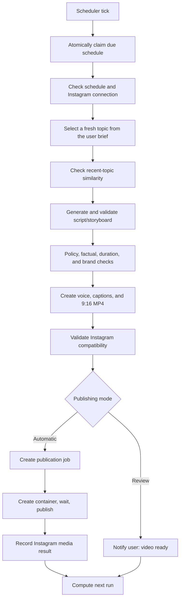
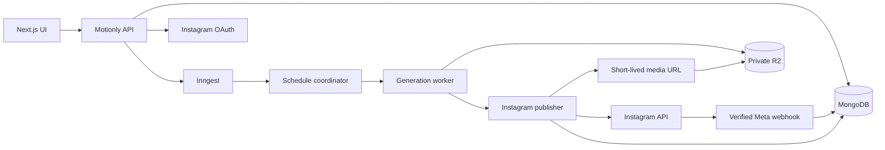

# Motionly AI — Instagram Integration Design

Last reviewed: 2026-11-10

## 1. Purpose and scope

Motionly supports two Instagram publishing paths:

1. **Manual publishing:** after reviewing a completed video, the user approves it and publishes it to a connected Instagram account.
2. **Automatic scheduled publishing:** the user creates a recurring content brief, such as “Every day at 10:00 AM, create one interesting beginner-friendly technology video and publish it as a Reel.”

One-time future publishing is also supported as a manual-publishing option. Billing remains outside V1.

## 2. Product rules

- The primary journey is idea → video plan → approved video → publish.
- Manual publishing requires explicit per-video approval.
- Automatic publishing is a separate, explicit opt-in made when activating a schedule.
- A schedule authorizes only the runs created from that schedule and can be paused immediately.
- Failed or uncertain quality checks stop publication and request review.
- Download for Instagram remains available without connecting an account.
- Motionly does not promise revenue, reach, followers, or engagement.

## 3. Meta platform requirements

Use **Instagram API with Instagram Login** for Instagram professional accounts.

### Eligibility and permissions

- Supported accounts: Instagram Business and Creator accounts.
- Personal/consumer accounts cannot use API publishing.
- Required scopes: `instagram_business_basic` and `instagram_business_content_publish`.
- Motionly never asks for or stores the user’s Instagram password.

### Reel publishing sequence

1. Render and validate the approved MP4.
2. Expose the asset with a short-lived, unguessable HTTPS URL that Meta can fetch.
3. Create a media container with `media_type=REELS`, `video_url`, caption, and `share_to_feed`.
4. Poll the container with bounded backoff until its status is `FINISHED`.
5. Call `media_publish` once.
6. Store the Instagram media ID and permalink when available.
7. Revoke or expire the temporary fetch URL.

Query the account-specific content-publishing limit before admission; do not hard-code a daily post count.

### Media compatibility gate

Validate the active Meta requirements immediately before publishing. Current Reel guidance includes:

- MOV or MP4 container.
- H.264 or HEVC video and AAC audio at 48 kHz.
- 23–60 FPS.
- 9:16 recommended; maximum 1920 horizontal pixels.
- 3 seconds to 15 minutes.
- Maximum 1 GB.

Motionly’s default 9:16 H.264/AAC MP4 at 30 FPS fits this profile. Provider limits remain configuration-driven and must be rechecked before production launch.

## 4. User experience

### 4.1 Connect Instagram

Settings includes an Instagram section with:

- **Connect Instagram**.
- A note that publishing requires a Creator or Business account.
- Meta-hosted OAuth consent.
- Connected username, account type, permissions, and connection health.
- **Reconnect** when authorization expires.
- **Disconnect**, which pauses dependent schedules.

### 4.2 Manual publishing

On **Your video is ready**:

1. User previews the completed Reel.
2. User selects **Publish to Instagram**.
3. If needed, the user connects Instagram and returns to the publish dialog.
4. User confirms account, caption/hashtags, Share to Feed, and either **Publish now** or a future local date/time.
5. Motionly displays Preparing → Sending to Instagram → Published.

Retries reuse the same publication intent and must never create a duplicate post.

### 4.3 Recurring automatic schedule

The schedule form captures:

- Schedule name.
- Content theme and audience.
- Goal, tone, key points, visual style, and prohibited topics.
- Duration, voice, language, captions, and background-music defaults.
- Instagram account, caption template, hashtags, and Share to Feed.
- Daily or selected-weekday frequency.
- Local publish time and IANA timezone, for example `Asia/Kolkata`.
- Publishing mode:
  - `REQUIRE_REVIEW`: generate and notify the user.
  - `AUTO_PUBLISH`: generate and publish after all checks pass.

Activating `AUTO_PUBLISH` requires a final confirmation showing the account, content theme, frequency, local time, and that future videos will be posted without per-video approval.

Each schedule displays status, Instagram account, next run, last result, upcoming topic when known, and actions for Pause, Edit, Run now, and View history.

## 5. Automatic content workflow



### Topic freshness

- The schedule brief defines the allowed subject area.
- Store a normalized topic fingerprint for every run.
- Compare proposed topics with a configurable recent-history window.
- Reject near-duplicates and select another topic.
- Do not generate time-sensitive claims without an approved source workflow.
- If no safe, fresh topic is available, skip the run and notify the user.

### Automatic publishing gates

All gates must pass:

- Storyboard schema and semantic validation.
- Content-policy and schedule prohibited-topic checks.
- Factual-risk policy appropriate to the content category.
- Caption and hashtag validation.
- Audio, duration, ratio, codec, and file-size validation.
- Duplicate-topic check.
- Active Instagram connection with publish permission.
- Available account-specific publishing capacity.

Any ambiguous gate moves the run to `NEEDS_REVIEW`; it does not publish.

## 6. Scheduling semantics

- Store the IANA timezone and local wall-clock time.
- Store `nextRunAt` in UTC for worker queries.
- Recalculate the next occurrence after every terminal run and schedule edit.
- Preserve local time across daylight-saving changes. Run once during repeated times; move to the first valid time after a nonexistent local time.
- Atomically claim due occurrences with a lease.
- Use `scheduleId + scheduledFor` as the deterministic occurrence idempotency key.
- Skip occurrences outside a configurable grace window rather than posting unexpectedly late.
- Editing a schedule does not alter a run already in progress.

## 7. State models

### Schedule

```text
DRAFT → ACTIVE ↔ PAUSED
ACTIVE → NEEDS_ATTENTION → ACTIVE
DRAFT|ACTIVE|PAUSED → ARCHIVED
```

### Schedule run

```text
QUEUED → SELECTING_TOPIC → PLANNING → REVIEWING_QUALITY → GENERATING
→ READY_FOR_REVIEW | PUBLISH_QUEUED → PUBLISHED

Any active state → NEEDS_REVIEW | FAILED | CANCELED
Missed occurrence → SKIPPED
```

### Publication job

```text
QUEUED → PREPARING_MEDIA → CREATING_CONTAINER → PROCESSING_CONTAINER
→ PUBLISHING → PUBLISHED

Any active state → RETRY_WAIT → previous safe checkpoint
Any active state → FAILED
QUEUED|RETRY_WAIT → CANCELED
```

`PUBLISHED` is terminal. A retry inspects saved provider IDs before creating any new container.

## 8. Component architecture



New services:

- `InstagramConnectionService`: OAuth state, code exchange, account capability, health, and disconnect.
- `ScheduleService`: validation, next-run calculation, pause/resume, and occurrence admission.
- `ScheduledContentService`: topic selection, duplicate checks, generation, and quality gates.
- `InstagramPublisher`: limit check, container creation, polling, publish, and normalized errors.
- `PublicationRepository`: provider-safe idempotency and history.

## 9. API extension

All routes are under `/api/v1`.

### Connections

| Method   | Route                                             | Purpose                                     |
| -------- | ------------------------------------------------- | ------------------------------------------- |
| `POST`   | `/integrations/instagram/oauth/start`             | Return signed Meta authorization URL        |
| `GET`    | `/integrations/instagram/oauth/callback`          | Validate state, exchange code, save account |
| `GET`    | `/integrations/instagram/connections`             | List connected accounts                     |
| `GET`    | `/integrations/instagram/connections/:id`         | Read health and capabilities                |
| `POST`   | `/integrations/instagram/connections/:id/refresh` | Recheck/refresh connection                  |
| `DELETE` | `/integrations/instagram/connections/:id`         | Disconnect and pause schedules              |

### Publications

| Method | Route                               | Purpose                            |
| ------ | ----------------------------------- | ---------------------------------- |
| `POST` | `/projects/:projectId/publications` | Publish now or schedule once       |
| `GET`  | `/projects/:projectId/publications` | List project publication history   |
| `GET`  | `/publications/:id`                 | Read normalized publish status     |
| `POST` | `/publications/:id/retry`           | Retry a safe failed checkpoint     |
| `POST` | `/publications/:id/cancel`          | Cancel before provider publication |

### Recurring schedules

| Method   | Route                     | Purpose                               |
| -------- | ------------------------- | ------------------------------------- |
| `POST`   | `/schedules`              | Create schedule                       |
| `GET`    | `/schedules`              | List schedules                        |
| `GET`    | `/schedules/:id`          | Read schedule and next run            |
| `PATCH`  | `/schedules/:id`          | Edit brief, defaults, timing, or mode |
| `POST`   | `/schedules/:id/activate` | Explicitly activate schedule          |
| `POST`   | `/schedules/:id/pause`    | Pause future occurrences              |
| `POST`   | `/schedules/:id/run-now`  | Create one immediate occurrence       |
| `GET`    | `/schedules/:id/runs`     | List topics, videos, and outcomes     |
| `DELETE` | `/schedules/:id`          | Archive schedule and retain history   |

### Webhook

- `GET /webhooks/meta`: Meta verification.
- `POST /webhooks/meta`: validate signature and accept supported events.

Publication-creating POST requests require `Idempotency-Key`. Schedule updates require `If-Match` optimistic concurrency.

## 10. Database extension

### `socialConnections`

Owner-scoped Instagram account identity, account type, granted scopes, capability flags, health status, encrypted access token, expiry, last check, version, and timestamps.

Indexes:

- Unique partial `{ ownerId, provider, providerAccountId }` for active connections.
- `{ ownerId, status, updatedAt }`.
- `{ status, tokenExpiresAt }`.

### `publishingSchedules`

Owner, connection, content brief, video defaults, caption template, frequency, local time, timezone, publishing mode, status, next/last run, lease, failure count, version, and timestamps.

Indexes:

- `{ ownerId, status, nextRunAt }`.
- `{ status, nextRunAt, leaseExpiresAt }` for claims.
- `{ connectionId, status }` for pause-on-disconnect.

### `scheduleRuns`

One occurrence per intended local time: schedule/owner, `scheduledFor`, idempotency key, selected topic, fingerprint, project/generation/publication links, quality results, history, error summary, and timestamps.

Indexes:

- Unique `{ scheduleId, scheduledFor }`.
- Unique `{ ownerId, idempotencyKey }`.
- `{ scheduleId, createdAt: -1 }`.
- `{ scheduleId, topicFingerprint, createdAt: -1 }`.

### `publicationJobs`

Owner, connection, project, asset, optional schedule run, origin, publish time, caption, Share to Feed, state/attempt/history, idempotency key, provider container/media IDs, permalink, normalized error, lease, and timestamps.

Indexes:

- Unique `{ ownerId, idempotencyKey }`.
- Unique sparse `{ provider, providerMediaId }`.
- `{ status, publishAt, leaseExpiresAt }`.
- `{ ownerId, projectId, createdAt: -1 }`.

## 11. Reliability and idempotency

- Create the local publication before calling Meta.
- Persist the container ID immediately.
- On retry, inspect saved provider state before creating a container.
- Separate provider acceptance from local completion to prevent duplicate posts after database timeouts.
- Use bounded exponential backoff with jitter.
- Do not automatically retry revoked permissions, unsupported media, or policy failures.
- Repeated schedule failures set `NEEDS_ATTENTION`, pause new runs, and notify the user.
- Dispatch generation/publication work through the workflow outbox after durable writes.

## 12. Security and privacy

- OAuth state is signed, single-use, short-lived, and bound to the logged-in user.
- Tokens use envelope encryption; encryption keys remain outside MongoDB.
- Tokens, authorization codes, signed URLs, captions, and raw provider responses never enter browser logs or analytics.
- Meta webhook signatures are verified.
- Temporary media URLs are asset-scoped, unguessable, short-lived, and revocable.
- Disconnect clears usable token material according to policy and pauses dependent schedules.
- Audit connection, disconnect, schedule activation, auto-publish confirmation, pause, publish, retry, and result events.

## 13. Notifications and observability

Notify the user when a connection succeeds or needs repair, a review video is ready, a Reel is published, a run is skipped/moved to review, publishing fails, or a schedule is paused after repeated failures.

Track connection health, due/claimed/completed/skipped runs, generation-to-publish latency, container processing time, publication success/failure categories, duplicate prevention, token failures, and account-specific limit headroom. Never place captions, topics, tokens, or signed URLs in metric labels.

## 14. Delivery plan

1. **Manual publish:** Meta app/App Review, OAuth, media validation, publish now, history, retries, notifications.
2. **One-time schedule:** future local date/time, cancel/reschedule, timezone-safe admission.
3. **Recurring automation:** schedule builder, topic freshness, quality gates, review and auto-publish modes, pause/history/run-now.
4. **Later optimization:** multiple Instagram accounts, calendar view, and optional insights after separate permission/privacy review.

## 15. Acceptance criteria

- An eligible Creator/Business account can be connected without sharing a password with Motionly.
- A completed approved Reel can be manually published without duplicate posts on retry.
- An approved Reel can be scheduled once in the user’s timezone.
- A recurring schedule can run daily at 10:00 AM local time.
- Automatic runs select a fresh topic, generate a valid video, and publish only after all gates pass.
- Uncertain content or technical failures stop publication and request review.
- Disconnecting Instagram pauses dependent schedules.
- Users can pause automatic publishing immediately and view every run/publish outcome.
- Billing and payments remain absent.

## 16. Authoritative references

- [Meta Instagram Platform — Content Publishing](https://developers.facebook.com/docs/instagram-platform/content-publishing)
- [Meta Instagram API collection — Postman](https://www.postman.com/meta/instagram/documentation/6yqw8pt/instagram-api)
- [Meta Instagram API — Publish Reel](https://www.postman.com/meta/instagram/request/gabnx7r/publish-reel)
