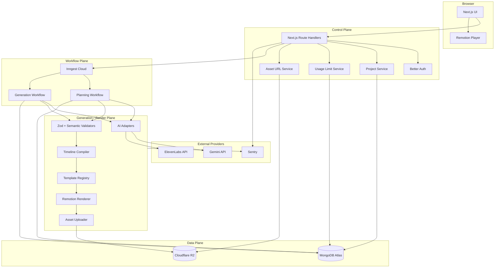
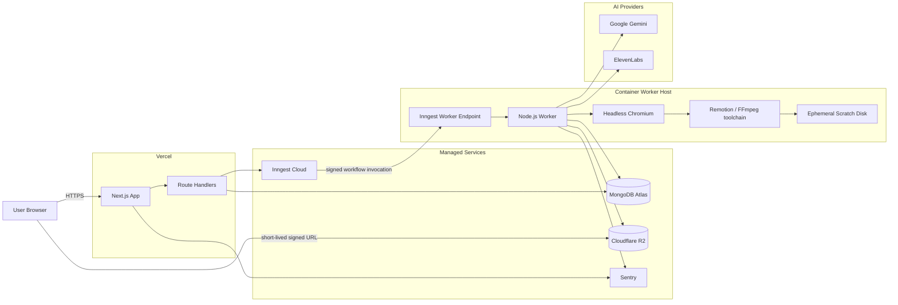
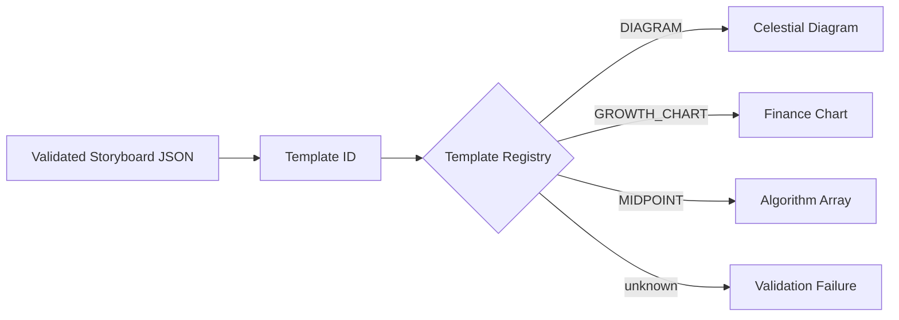
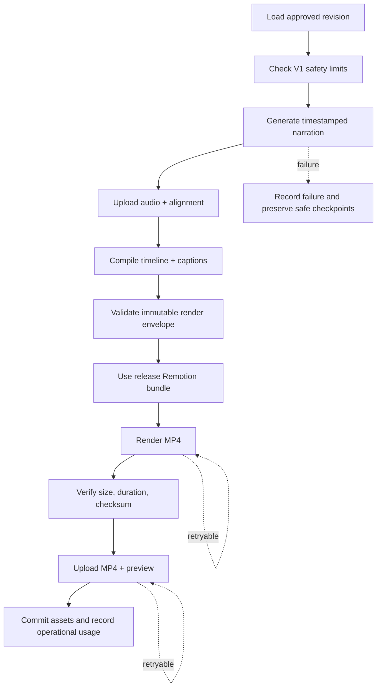
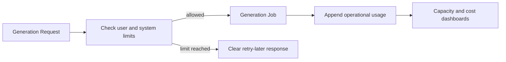
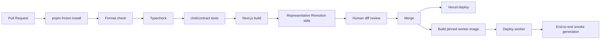

# Motionly AI — System Architecture

**Status:** Target architecture for M3–M5  
**Last reviewed:** 2026-11-10  
**Companion document:** [System Design](./SYSTEM_DESIGN.md)

## 1. Architecture principles

1. **AI returns data, never code.** All provider output is untrusted and validated.
2. **Preview equals render.** The Remotion Player and server renderer receive the same JSON-serializable props.
3. **Review before generation.** Provider-consuming narration and rendering start only from an approved immutable revision.
4. **Control plane and render plane are separate.** Web latency and render load scale independently.
5. **Every external side effect is idempotent.** Retries must not duplicate provider operations or final assets.
6. **Private by default.** Projects and media are tenant-scoped and never permanently public.
7. **Version everything.** Schema, templates, model settings, voice, render configuration, and code release are recorded per job.
8. **Prefer measured evolution.** Start with a container worker; adopt Lambda or additional infrastructure only after benchmarks.

## 2. Logical component architecture



## 3. Deployment topology



### Why rendering is not inside the normal web request

Remotion rendering launches Chromium, evaluates hundreds or thousands of frames, uses significant CPU/memory, and writes media files. Keeping it in a dedicated worker provides:

- Independent concurrency and memory limits.
- Ephemeral disk sized for render intermediates.
- Clean retries after Chromium failures.
- No user request waiting for an MP4.
- A migration path to Remotion Lambda without changing APIs or project data.

Vercel remains suitable for request/response control-plane work, but worker execution is the canonical render path even where long function durations are technically available.

## 4. Repository target structure

```text
motionly-ai/
├─ apps/
│  ├─ web/                      # Next.js UI, Route Handlers, auth, webhooks
│  └─ worker/                   # Inngest workflows and Remotion render execution
├─ packages/
│  ├─ ai/                       # Gemini and ElevenLabs provider adapters
│  ├─ auth/                     # Better Auth configuration and session helpers
│  ├─ db/                       # Mongo client, repositories, indexes
│  ├─ jobs/                     # Events, workflow contracts, state transitions
│  ├─ storage/                  # R2 adapter, signed URLs, checksums
│  ├─ usage/                    # Operational metering and V1 safety limits
│  ├─ shared/                   # Zod contracts, domain types, timeline compiler
│  ├─ video/                    # Remotion composition and template registry
│  ├─ observability/            # Logging, tracing, metrics, redaction
│  └─ config/                   # Typed environment and shared configuration
├─ docs/                        # Design, architecture, ADRs, runbooks
├─ infrastructure/              # Deployment manifests and environment examples
├─ storage/                     # Local-only generated data, ignored by Git
└─ out/                         # Local-only rendered output, ignored by Git
```

## 5. Package boundaries

### `apps/web`

Responsible for:

- Dashboard, project editor, review UI, progress UI, player, downloads.
- Authentication session enforcement.
- Thin Route Handlers that call domain services.
- Inngest webhook endpoint and job-status APIs.
- Signed asset URL requests.

Must not:

- Render full videos.
- Expose provider credentials.
- Import worker-only filesystem or Chromium code.
- Trust client-provided ownership or job status.

### `apps/worker`

Responsible for:

- Inngest planning and generation workflows.
- Provider calls, validation, timeline compilation, rendering, upload.
- Job progress/state transitions and usage records.
- Cleanup of ephemeral local files.

Must not:

- Serve product pages.
- Accept arbitrary unauthenticated render props.
- render unregistered templates or remote scripts.

### `packages/shared`

Contains pure, deterministic code:

- API/domain schemas.
- Storyboard schema and semantic validators.
- Timeline compiler.
- Job state/event contracts.
- Content hashing and version identifiers.

It may not import Next.js, MongoDB, provider SDKs, filesystem APIs, or Remotion rendering APIs.

### `packages/video`

Contains:

- Root composition and Zod render-prop schema.
- Template registry.
- React/SVG visual primitives.
- Caption renderer.
- Theme and layout tokens.

It accepts validated JSON props and produces deterministic frames. It does not call Gemini, ElevenLabs, MongoDB, or R2.

### Provider packages

Every external service sits behind a narrow interface:

```ts
interface StoryboardProvider {
  generate(input: PlanningInput): Promise<StoryboardDraft>;
}

interface SpeechProvider {
  generate(input: SpeechRequest): Promise<TimestampedAudio>;
}

interface RenderProvider {
  render(input: ImmutableRenderInput): Promise<RenderedMedia>;
}

interface ObjectStore {
  put(input: PutObjectInput): Promise<StoredObject>;
  signGet(key: string, ttlSeconds: number): Promise<string>;
}
```

Provider-specific response types do not escape their adapters.

## 6. Template registry architecture

Model output refers to template identifiers, never component names or code.



Each registry entry declares:

- Stable template ID and version.
- Compatible object/action schema.
- React component.
- Default accessibility label.
- Safe theme/layout parameters.
- Optional deterministic semantic validator.

Example target contract:

```ts
type TemplateDefinition = {
  id: TemplateId;
  version: number;
  sceneSchema: ZodSchema;
  component: React.ComponentType<TemplateProps>;
  validateSemantics?: (scene: StoryboardScene) => ValidationIssue[];
};
```

Adding a template requires tests, preview fixtures, and visual review. A model prompt update alone cannot add executable behavior.

## 7. Immutable render input

Every approved generation creates one immutable input envelope:

```ts
type RenderEnvelope = {
  schemaVersion: "0.1";
  templateRegistryVersion: string;
  projectId: string;
  versionId: string;
  jobId: string;
  storyboard: Storyboard;
  captions: CaptionCue[];
  audio: {
    storageKey: string;
    sha256: string;
    playbackRate: number;
  };
  output: {
    width: 720;
    height: 1280;
    fps: 30;
    durationInFrames: number;
    codec: "h264";
  };
  provenance: {
    appRelease: string;
    geminiModel?: string;
    speechModel: string;
    voiceId: string;
  };
};
```

The envelope is validated, hashed, stored, and passed unchanged to preview and render. Its hash is recorded on the job and final asset.

## 8. Workflow architecture

### 8.1 Events

| Event                                  | Producer            | Consumer                        |
| -------------------------------------- | ------------------- | ------------------------------- |
| `motionly/project.plan.requested`      | Web API             | Planning workflow               |
| `motionly/project.plan.completed`      | Planning workflow   | Notifications/status projection |
| `motionly/generation.requested`        | Web API             | Generation workflow             |
| `motionly/generation.cancel.requested` | Web API             | Generation workflow             |
| `motionly/generation.completed`        | Generation workflow | Usage, notification, analytics  |
| `motionly/generation.failed`           | Failure handler     | Status, cleanup, and alerting   |
| `motionly/schedule.run.requested`      | Schedule dispatcher | Scheduled-content workflow      |
| `motionly/publication.requested`       | Web/schedule worker | Instagram publishing workflow   |
| `motionly/publication.completed`       | Publishing workflow | Status, notification, analytics |
| `motionly/publication.failed`          | Failure handler     | Status, retry, and notification |
| `motionly/account.delete.requested`    | Web API             | Data-purge workflow             |

Events contain identifiers and small metadata only. Large storyboards, alignments, and media remain in MongoDB/R2.

### 8.2 Generation function



### 8.3 State-transition safety

Job transitions use compare-and-set updates:

```text
updateOne(
  { _id: jobId, status: expectedStatus, attempt },
  { $set: { status: nextStatus, updatedAt }, $push: { history: event } }
)
```

If the modified count is zero, another attempt or cancellation has already changed the job and the worker must reload state rather than overwrite it.

## 9. Database access architecture

Use the official MongoDB Node.js driver through repositories. Domain services do not call collections directly.

```text
Route Handler / Workflow
        ↓
Domain Service
        ↓
Repository Interface
        ↓
MongoDB Driver
```

Rules:

- Repository methods require `ownerId` for tenant-owned reads/writes.
- Projection excludes large storyboard/history fields from list pages.
- Single-document atomicity is preferred.
- Transactions are reserved for invariants spanning multiple documents, such as job admission plus its usage record.
- Index definitions live in code and are checked during deployment.
- No raw provider errors or secrets are persisted.

## 10. Asset architecture

### Upload path

1. Worker writes to a unique temporary local directory.
2. Renderer produces the file outside the repository tree.
3. Worker computes SHA-256 and reads media metadata.
4. Worker uploads to a deterministic private R2 key.
5. Worker verifies object size/checksum.
6. MongoDB asset record is committed.
7. Temporary local directory is deleted.

### Download path

1. Browser requests `/api/assets/:id/url`.
2. API loads the asset with `ownerId` scope.
3. API creates a short-lived signed R2 URL.
4. Browser streams directly from R2; Vercel does not proxy the MP4.

### Retention

- Final MP4: retained until user deletion or the documented V1 retention limit.
- Narration and render props: retained with the project for reproducibility.
- Preview image: retained with final output.
- Render intermediates: deleted after success; failed-job intermediates expire within 24 hours.

## 11. Authentication and authorization

Better Auth runs in the Next.js control plane with the official MongoDB adapter.

Initial providers:

- Better Auth email/password with mandatory email verification.
- Resend transactional email for verification and password recovery.

Authorization model:

- V1 resource owner: individual user.
- Every project, job, asset, and usage record carries `ownerId`.
- Admin access is an explicit server-side role and is audit logged.
- Future organizations add `workspaceId`; they do not replace `ownerId` silently.

Sessions are HTTP-only, secure, same-site cookies. No provider API key or storage credential is placed in the session.

An Instagram connection is a linked publishing account, not an application login method. OAuth access tokens are encrypted server-side, excluded from sessions and API responses, and scoped to the minimum publishing permissions. Connection health, manual approval, recurring authorization, disconnect behavior, and automatic publishing controls are specified in [Instagram integration design](./INSTAGRAM_INTEGRATION_DESIGN.md).

## 12. V1 usage limits

V1 has no billing, subscriptions, payments, or internal credits. Admission control exists only to protect provider accounts and infrastructure.



Limits are configuration-driven and may include concurrent jobs, daily generations, maximum duration, and retained storage. Usage records are operational telemetry; they do not represent customer charges. Monetization is a post-V1 concern and is intentionally absent from this architecture baseline.

## 13. Rendering architecture

### Phase A — local/M3

- Remotion CLI or Node SSR on the developer machine.
- Local ignored `storage/` and `out/` directories.
- One job at a time.

### Phase B — hosted worker/M4

- Container image with exact Node, Chromium, Remotion, and font versions.
- One prebuilt Remotion bundle per application release.
- Worker concurrency starts at one render per container.
- Ephemeral disk limit and job timeout are explicit.
- Worker reads immutable props and audio, then uploads to R2.

### Phase C — Remotion Lambda/M6

- Deploy versioned Remotion bundle to AWS S3.
- Invoke parallel Lambda rendering for eligible jobs.
- Copy or replicate final output to the canonical asset store if R2 remains primary.
- Record AWS render ID and bundle version in job provenance.

The `RenderProvider` interface isolates these phases.

## 14. Configuration and secrets

### Public configuration

- Product URL and feature flags safe for the browser.
- Maximum UI duration choices.

### Server-only configuration

- MongoDB URI and database.
- Better Auth secret and OAuth secrets.
- Inngest signing/event keys.
- Sentry DSN/configuration according to exposure policy.

### Worker-only configuration

- Gemini key and model identifier.
- ElevenLabs key, model, and approved voice IDs.
- R2 endpoint, bucket, access key, and secret.
- Render concurrency, scratch path, and timeouts.

Configuration is parsed once at process start with Zod. Production startup fails on missing or malformed required variables.

## 15. CI/CD architecture



Required gates:

- Lockfile unchanged unless dependency update is intentional.
- All Remotion packages use the exact same version.
- Storyboard fixtures parse successfully.
- Timeline tests verify exact frame totals.
- Visual snapshots cover every registered template.
- Dependency/security scan blocks known critical issues.
- Production deploy records release SHA for job provenance.

## 16. Observability architecture

### Correlation

Generate a request ID at the edge and preserve it through API, Inngest event, worker, provider metadata, asset records, and logs.

### Sentry boundaries

- Browser: UI errors and failed API interactions; no private script bodies by default.
- Web server: Route Handler exceptions, slow database calls, webhook failures.
- Worker: provider latency, render exceptions, out-of-memory/timeout context.

### Structured log example

```json
{
  "level": "info",
  "event": "generation.step.completed",
  "jobId": "...",
  "step": "render",
  "attempt": 1,
  "durationMs": 24109,
  "release": "git-sha",
  "templateRegistryVersion": "2026-11-09.1"
}
```

Do not log secrets, signed URLs, full auth cookies, or unredacted provider headers.

## 17. Failure scenarios and recovery

| Scenario                 | Detection                       | Recovery                                                                    |
| ------------------------ | ------------------------------- | --------------------------------------------------------------------------- |
| Gemini 429/503           | Provider status and retry-after | Bounded retry; deterministic fallback or user retry                         |
| Invalid model JSON       | Zod/semantic failure            | One constrained repair attempt; then reviewable failure                     |
| ElevenLabs account limit | 402/provider code               | Stop job, keep approval, request account action                             |
| Ambiguous TTS timeout    | Missing response after request  | Check provider/request history where available; avoid blind duplicate spend |
| Chromium crash           | Render process exit             | Retry on clean worker from immutable props                                  |
| Worker terminated        | Inngest step timeout/heartbeat  | New attempt reuses completed steps                                          |
| R2 upload interrupted    | Upload/checksum mismatch        | Retry same deterministic key or multipart upload                            |
| MongoDB transient error  | Driver error labels             | Driver/transaction retry where safe                                         |
| User cancellation        | Cancellation flag/event         | Stop before next side effect; clean temporary assets                        |

## 18. Environment topology

| Environment | Database                                    | Storage                   | Providers                        | Purpose                              |
| ----------- | ------------------------------------------- | ------------------------- | -------------------------------- | ------------------------------------ |
| Local       | Local MongoDB or dev Atlas DB               | Local filesystem / dev R2 | Test credentials                 | Development and manual render review |
| Preview     | Isolated Atlas DB or namespaced collections | Preview R2 prefix/bucket  | Restricted test credentials      | Pull-request QA                      |
| Staging     | Dedicated Atlas DB                          | Staging bucket            | Staging/live-low-quota providers | End-to-end release validation        |
| Production  | Production Atlas cluster                    | Production private bucket | Production credentials           | Customer workloads                   |

No environment shares webhook secrets, object-storage write credentials, or database names.

## 19. Current-to-target gap map

| Area              | Current POC                               | Target                                                |
| ----------------- | ----------------------------------------- | ----------------------------------------------------- |
| UI                | Single review page                        | Dashboard, editor, progress, history, player          |
| Data              | Fixtures and ignored local JSON           | MongoDB projects, revisions, jobs, assets             |
| Jobs              | Manual scripts                            | Inngest durable workflows                             |
| Storage           | Local ignored folders                     | Private R2 with signed URLs                           |
| Render            | Local Remotion CLI                        | Container worker; Lambda option later                 |
| Auth              | None                                      | Better Auth + Google OAuth + MongoDB adapter          |
| Usage limits      | None                                      | Configurable safety limits and operational metering   |
| Monitoring        | Terminal output                           | Sentry, structured logs, metrics, alerts              |
| AI resilience     | Bounded Gemini retry and fixture fallback | Durable retries, provider metadata, admin retry tools |
| Template registry | Schema enum and component branch          | Versioned registry with per-template schemas/tests    |

## 20. Architecture decision records to create

1. `ADR-001`: AI output is constrained data, not executable code.
2. `ADR-002`: Control plane is separated from render plane.
3. `ADR-003`: MongoDB official driver over an ODM for V1.
4. `ADR-004`: Cloudflare R2 as canonical media store for hosted MVP.
5. `ADR-005`: Inngest for durable generation workflows.
6. `ADR-006`: Better Auth with the MongoDB adapter.
7. `ADR-007`: Container rendering first, Remotion Lambda after benchmark threshold.
8. `ADR-008`: Immutable project revisions and generation provenance.

## 21. Operational readiness checklist

Before private beta:

- [ ] Database indexes verified in staging.
- [ ] R2 bucket private; CORS restricted; signed URLs tested.
- [ ] Worker image pins fonts, Chromium, Node, and Remotion.
- [ ] Retry and cancellation tests pass.
- [ ] Provider 402/429/503 failure paths are visible in the UI.
- [ ] Account deletion purges database and storage.
- [ ] Secret scanning and dependency scanning run in CI.
- [ ] Restore/backup process for MongoDB is documented and tested.
- [ ] Queue depth and failure alerts are active.
- [ ] Remotion and ElevenLabs commercial-use terms are reviewed.
- [ ] One full staging generation is part of release smoke testing.

## 22. Reference links

- [Next.js Route Handlers](https://nextjs.org/docs/app/getting-started/route-handlers)
- [Remotion server rendering options](https://www.remotion.dev/docs/render)
- [Remotion Lambda architecture](https://www.remotion.dev/docs/lambda)
- [Inngest error handling and retries](https://www.inngest.com/docs/durable-execution/guides-and-advanced/error-handling)
- [Cloudflare R2 S3 API](https://developers.cloudflare.com/r2/get-started/s3/)
- [MongoDB indexes](https://www.mongodb.com/docs/drivers/node/current/indexes/)
- [MongoDB transactions](https://www.mongodb.com/docs/drivers/node/v6.x/crud/transactions/)
- [Better Auth MongoDB adapter](https://better-auth.com/docs/adapters/mongo)
- [Gemini structured output](https://ai.google.dev/gemini-api/docs/structured-output)
- [ElevenLabs speech with timing](https://elevenlabs.io/docs/api-reference/text-to-speech/convert-with-timestamps)
