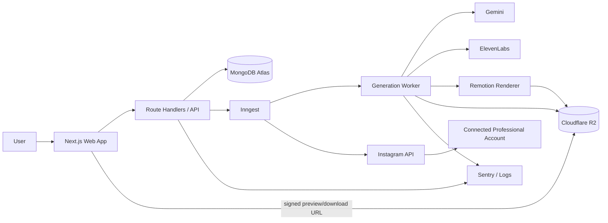
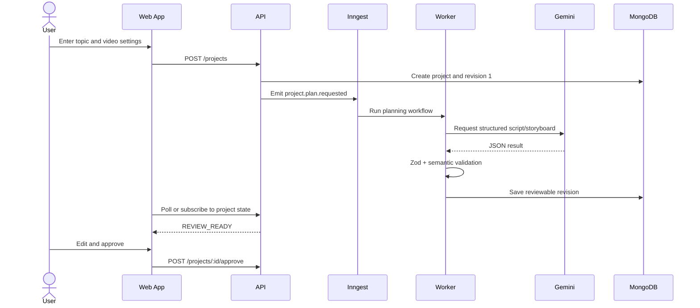
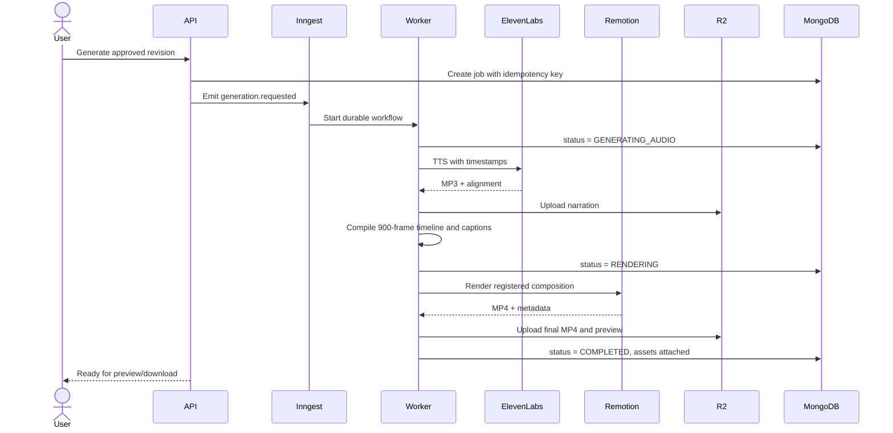
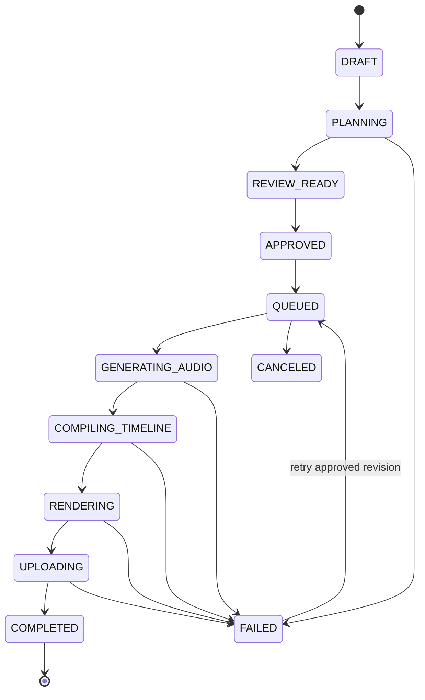
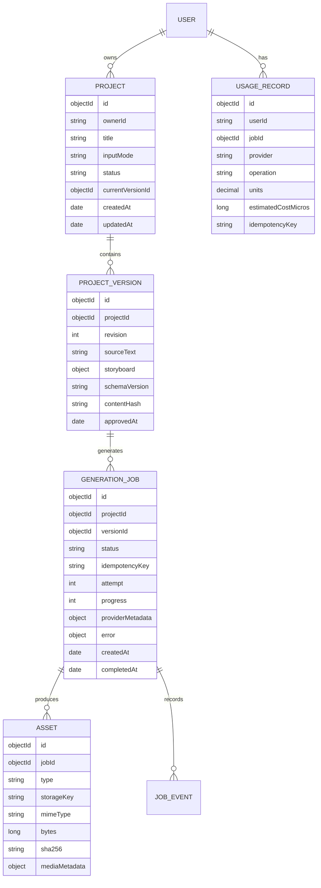

# Motionly AI — System Design

**Status:** Approved baseline for M3 implementation  
**Last reviewed:** 2026-11-10  
**Owners:** Product and engineering  
**Scope:** Educational motion-graphics SaaS, from topic or script to downloadable MP4

## 1. Executive summary

Motionly AI converts a topic or user-supplied script into a deterministic, narrated motion-graphics video. AI produces constrained content data; it never produces executable UI or rendering code. A user reviews the script and storyboard before provider-consuming narration and rendering begin.

The target system separates:

- **Control plane:** authentication, projects, review UI, API, usage limits, and job status.
- **Generation plane:** structured storyboard generation, narration, timeline compilation, rendering, and asset upload.
- **Storage plane:** MongoDB for metadata and object storage for generated media.

The POC has already validated the core renderer with science, finance, and computer-science videos.

## 2. Goals

### Product goals

1. Accept either a topic or a complete script.
2. Produce a reviewable script and structured storyboard.
3. Require approval before narration/rendering uses external provider resources.
4. Generate 9:16 narrated explainers with synchronized captions.
5. Preserve user-supplied script wording unless the user explicitly edits it.
6. Show generation progress, failures, retry options, preview, and download.
7. Maintain project history and immutable generation revisions.
8. Track provider usage and enforce V1 safety limits.

### Engineering goals

1. Deterministic rendering from validated JSON input.
2. No execution of model-generated code, URLs, HTML, or JSX.
3. Retry-safe workflows with idempotent side effects.
4. Horizontal scaling of render workers without changing the web application.
5. Provider adapters so Gemini, ElevenLabs, storage, and rendering can be replaced.
6. Strong tenant isolation and private-by-default assets.

## 3. Non-goals for V1

- General-purpose text-to-video diffusion.
- User-authored React or arbitrary animation code.
- A full timeline editor comparable to After Effects.
- Real-time collaborative editing.
- Long-form videos above five minutes.
- User voice cloning.
- AI-generated background images or stock-footage search.
- Billing, subscriptions, payments, and internal credits. These are explicitly deferred until after V1.

## 4. Validated product assumptions

The following have been demonstrated by working POCs:

| Domain           | Video             | What it validated                                                     |
| ---------------- | ----------------- | --------------------------------------------------------------------- |
| Science          | Solar eclipse     | Diagram animation, spatial relationships, voice/caption sync          |
| Finance          | Compound interest | Number flow, formula, bar chart, comparison graph                     |
| Computer science | Binary search     | Arrays, state elimination, target discovery, complexity visualization |

All three use the same 720 × 1280, 30 FPS, 900-frame composition contract and the same narration/caption pipeline.

## 5. Technology baseline

### 5.1 Versions already pinned in the repository

| Layer            | Tool/model              | Version or identifier           | Purpose                                         |
| ---------------- | ----------------------- | ------------------------------- | ----------------------------------------------- |
| Runtime          | Node.js                 | 24.16.0 installed; minimum 20.9 | Web, jobs, and render tooling                   |
| Package manager  | pnpm                    | 11.25.0                         | Monorepo dependency management                  |
| Web              | Next.js                 | 16.4.5                          | App Router UI and Route Handlers                |
| UI               | React / React DOM       | 19.3.1                          | Product UI and video compositions               |
| Language         | TypeScript              | 7.0.2                           | Strict types across the monorepo                |
| Validation       | Zod                     | 4.6.7                           | Request, storyboard, and render-prop validation |
| Video            | Remotion                | 4.0.541                         | Player, frame evaluation, and H.264 rendering   |
| AI SDK           | `@google/genai`         | 2.32.0                          | Gemini structured-output calls                  |
| Storyboard model | Gemini                  | `gemini-3.8-flash`              | Script/storyboard generation                    |
| Narration model  | ElevenLabs              | `eleven_multilingual_v2`        | Timestamped text-to-speech                      |
| Voice            | ElevenLabs Voice Design | `Motionly Indian Educator`      | Default English narration voice                 |
| Tests            | Vitest                  | 5.1.0                           | Contract and timeline tests                     |

### 5.2 Target M3/M4 dependencies

These are the implementation baseline verified against the npm registry on 2026-11-09. They must be pinned exactly when added; no floating production ranges.

| Capability            | Selection                    | Baseline version              | Decision                                         |
| --------------------- | ---------------------------- | ----------------------------- | ------------------------------------------------ |
| Authentication        | Better Auth                  | 1.7.18                        | Self-hosted TypeScript auth with Next.js support |
| Auth database adapter | `@better-auth/mongo-adapter` | 1.7.18                        | Reuse MongoDB Atlas and transaction support      |
| Database driver       | `mongodb`                    | 7.8.0                         | Official driver; avoid ODM coupling in V1        |
| Durable jobs          | `inngest`                    | 4.26.2                        | Step retries, traces, and failure handling       |
| Object storage client | `@aws-sdk/client-s3`         | 3.1164.0                      | Cloudflare R2 uses an S3-compatible API          |
| Error monitoring      | `@sentry/nextjs`             | 11.11.0                       | Browser/server errors and performance traces     |
| Web hosting           | Vercel                       | Managed service               | Next.js control plane                            |
| Metadata database     | MongoDB Atlas                | Managed service               | Projects, revisions, jobs, assets, usage         |
| Media storage         | Cloudflare R2                | S3-compatible managed service | Private audio, props, previews, MP4 files        |
| Render worker         | Node container + Remotion    | Same pinned repo versions     | Initial production render plane                  |
| Scale render option   | Remotion Lambda + AWS S3     | Same Remotion release family  | Adopt when parallel render demand justifies AWS  |

### 5.3 Model policy

| Task                      | Primary                  | Fallback                                      | Output contract                                             |
| ------------------------- | ------------------------ | --------------------------------------------- | ----------------------------------------------------------- |
| Topic → script/storyboard | `gemini-3.8-flash`       | Approved deterministic fixture or retry later | JSON matching the Zod storyboard schema                     |
| User script → storyboard  | `gemini-3.8-flash`       | Manual template selection                     | Script text is immutable; only storyboard data is generated |
| Narration                 | `eleven_multilingual_v2` | User retries after a provider failure         | MP3 plus character timestamps                               |
| Caption generation        | Local deterministic code | None required                                 | Five-word cues with exact start/end frames                  |
| Video rendering           | Remotion                 | Retry on a clean worker                       | H.264 MP4 from registered components only                   |

Model identifiers remain environment-configurable, but every generation records the exact model, settings, schema version, and template-registry version used.

## 6. High-level system flow



## 7. User workflows

### 7.1 Topic mode



### 7.2 Script mode

1. Store the supplied script as immutable source text in the revision.
2. Generate only scene segmentation, titles, templates, and animation actions.
3. Reject any model response whose narration differs from the approved script.
4. Show the storyboard for review before generating audio.

### 7.3 Approved generation flow



### 7.4 Instagram publishing

After a completed video passes validation, the user can download it, publish it immediately to a connected Instagram professional account, or schedule a one-time publication. Manual publication always requires explicit approval of that video.

Users may also create recurring content schedules, for example “Every day at 10:00 AM, create one beginner-friendly technology video.” A schedule can require review for every generated video or explicitly authorize automatic publication for that schedule. Automatic runs use timezone-aware scheduling, fresh-topic and duplicate checks, media validation, policy/quality gates, durable retries, and a complete run history. Disconnecting Instagram pauses dependent schedules.

The complete account-linking, publishing, scheduling, state-machine, API, and data design is in [Instagram integration design](./INSTAGRAM_INTEGRATION_DESIGN.md).

## 8. Job state model



Rules:

- Only an approved, immutable project revision can enter `QUEUED`.
- A retry creates a new job attempt; it never mutates a completed job.
- Cancellation is best-effort after TTS has started and cannot reverse provider usage.
- Progress is derived from durable step completion, not guessed from elapsed time.

## 9. Domain and data model



### 9.1 Collections

#### `projects`

- `_id`, `ownerId`, `title`, `inputMode`, `status`
- `topic` or `sourceScriptSummary`
- `currentVersionId`
- `createdAt`, `updatedAt`, `archivedAt`

Indexes:

- `{ ownerId: 1, updatedAt: -1 }`
- `{ ownerId: 1, status: 1, updatedAt: -1 }`

#### `projectVersions`

- `projectId`, `revision`, `sourceScript`, `storyboard`
- `schemaVersion`, `templateRegistryVersion`
- `modelConfig`, `renderConfig`, `contentHash`
- `approvedAt`, `approvedBy`

Indexes:

- Unique `{ projectId: 1, revision: 1 }`
- Unique `{ projectId: 1, contentHash: 1 }` where appropriate

#### `generationJobs`

- `ownerId`, `projectId`, `versionId`, `status`, `progress`
- `idempotencyKey`, `attempt`, `inngestRunId`
- `providerRequestIds`, `errorCode`, `safeErrorMessage`
- `createdAt`, `startedAt`, `completedAt`, `canceledAt`

Indexes:

- Unique `{ ownerId: 1, idempotencyKey: 1 }`
- `{ ownerId: 1, createdAt: -1 }`
- `{ status: 1, updatedAt: 1 }` for operations

#### `assets`

- `ownerId`, `projectId`, `jobId`, `type`
- `storageKey`, `mimeType`, `bytes`, `sha256`
- `durationSeconds`, `width`, `height`, `fps`
- `createdAt`, `expiresAt`

Indexes:

- `{ jobId: 1, type: 1 }`
- Unique `{ storageKey: 1 }`
- TTL index on `expiresAt` only for temporary assets

#### `usageRecords`

Append-only records for Gemini calls, TTS characters, render seconds, and storage bytes. Unique idempotency keys prevent duplicate operational-usage records during retries.

#### Instagram publishing collections

`socialConnections` stores encrypted Instagram account linkage and health metadata; `publishingSchedules` stores timezone-aware content briefs and approval mode; `scheduleRuns` records each planned occurrence; and `publicationJobs` tracks the idempotent Meta container and publish lifecycle. See [Instagram integration design](./INSTAGRAM_INTEGRATION_DESIGN.md) for schemas and indexes.

## 10. Object-storage layout

All buckets are private. Database records store keys, never permanent public URLs.

```text
users/{userId}/projects/{projectId}/versions/{versionId}/storyboard.json
users/{userId}/projects/{projectId}/jobs/{jobId}/narration.mp3
users/{userId}/projects/{projectId}/jobs/{jobId}/alignment.json
users/{userId}/projects/{projectId}/jobs/{jobId}/render-props.json
users/{userId}/projects/{projectId}/jobs/{jobId}/preview.jpg
users/{userId}/projects/{projectId}/jobs/{jobId}/video.mp4
```

Preview and download URLs are short-lived signed URLs, normally 10 minutes. The API verifies asset ownership before signing.

## 11. API surface

All mutation endpoints require authentication, CSRF/origin protection where applicable, Zod validation, ownership checks, and an idempotency key for expensive operations.

| Method  | Endpoint                                        | Purpose                                    |
| ------- | ----------------------------------------------- | ------------------------------------------ |
| `POST`  | `/api/projects`                                 | Create topic- or script-mode project       |
| `GET`   | `/api/projects`                                 | List current user's projects               |
| `GET`   | `/api/projects/:id`                             | Project, current revision, and latest job  |
| `PATCH` | `/api/projects/:id`                             | Rename or archive project                  |
| `POST`  | `/api/projects/:id/plan`                        | Generate script/storyboard draft           |
| `POST`  | `/api/projects/:id/versions`                    | Save edited review revision                |
| `POST`  | `/api/projects/:id/versions/:versionId/approve` | Freeze approved revision                   |
| `POST`  | `/api/projects/:id/generations`                 | Start approved generation                  |
| `GET`   | `/api/generations/:jobId`                       | Status, progress, and assets               |
| `POST`  | `/api/generations/:jobId/retry`                 | Retry from safe checkpoint                 |
| `POST`  | `/api/generations/:jobId/cancel`                | Best-effort cancellation                   |
| `GET`   | `/api/assets/:assetId/url`                      | Create signed preview/download URL         |
| `POST`  | `/api/inngest`                                  | Inngest function endpoint or worker bridge |

## 12. Validation and semantic rules

1. API request schemas and model response schemas are separate.
2. Storyboard JSON is parsed with Zod before persistence and again before rendering.
3. Total duration must resolve to the configured frame count.
4. Scene IDs must be unique and templates must exist in the registry.
5. Every action may reference only objects declared by its scene.
6. Script mode compares normalized narration against the approved source script.
7. Numeric/scientific claims may use deterministic validators for supported templates.
8. Unknown fields are rejected for security-sensitive contracts.
9. Render input is JSON-serializable and contains no functions or external URLs.

## 13. Reliability and idempotency

### Retry policy

| Step                 | Retry behavior                                                                                                          |
| -------------------- | ----------------------------------------------------------------------------------------------------------------------- |
| Gemini planning      | Retry 429/503 with bounded exponential backoff and jitter; then expose deterministic fallback or retry action           |
| ElevenLabs TTS       | Retry only clearly failed requests; preserve provider request IDs and narration hash to avoid ambiguous duplicate spend |
| Timeline compilation | Deterministic local retry                                                                                               |
| Rendering            | Retry on a clean worker; same immutable props and asset keys                                                            |
| R2 upload            | Multipart/idempotent retry; verify size and checksum                                                                    |
| MongoDB writes       | Atomic single-document transitions; transaction only for multi-document invariants                                      |

### Checkpointing

Each durable job step writes a completion record. Completed steps are reused on retry. External side effects use stable keys derived from `jobId + step + contentHash`.

### Error taxonomy

- `VALIDATION_*`: user or model output cannot satisfy the contract.
- `PROVIDER_RATE_LIMITED`: provider returned 429 or retry-after.
- `PROVIDER_UNAVAILABLE`: transient 5xx.
- `PROVIDER_ACCOUNT_LIMIT`: upstream provider account, quota, or plan limitation.
- `RENDER_*`: bundle, Chromium, frame, audio, or encode failure.
- `STORAGE_*`: upload, checksum, or signing failure.
- `INTERNAL_*`: unexpected defect; sanitized for users, detailed in monitoring.

## 14. Security and privacy

1. Secrets exist only in server/worker environment variables or a managed secret store.
2. Browser bundles never receive Gemini, ElevenLabs, R2, MongoDB, or worker credentials.
3. Every database query includes tenant ownership; never trust IDs from the route alone.
4. Assets are private and accessed through short-lived signed URLs.
5. Model output is untrusted input and is parsed, bounded, and semantically checked.
6. The worker renders only registered templates and local assets.
7. Arbitrary remote URL fetching, model-generated code, and shell execution are prohibited.
8. API routes enforce body-size limits, rate limits, and content-length checks.
9. Logs redact scripts if users mark projects private and always redact secrets/tokens.
10. Webhook signatures are verified before reading event intent.
11. Account deletion uses an asynchronous, auditable purge workflow for MongoDB and object storage.
12. Retention defaults: temporary render intermediates 24 hours; final assets until user deletion or the documented V1 retention limit.

## 15. Usage metering and V1 safety limits

- V1 has no billing, subscriptions, payments, or internal credit system.
- Enforce configurable per-user concurrency, daily generation, duration, and storage limits to protect infrastructure.
- Record provider model, characters, render duration, output bytes, and estimated internal cost for operations only.
- Do not duplicate usage records when a job retries with the same step idempotency key.
- Reject generation before provider calls when a safety limit or upstream provider quota has been reached.
- Administrators can adjust limits through server-side configuration; users do not purchase additional capacity in V1.

## 16. Observability

### Metrics

- Planning, TTS, render, and upload latency percentiles.
- Success/failure rate by provider, model, template, and worker version.
- Queue depth, oldest queued age, active renders, retries, and cancellations.
- Cost per completed video and provider usage variance.
- Output duration, render-time ratio, asset size, and signed-URL failures.

### Logs and traces

Every log includes `requestId`, `userId` hash, `projectId`, `versionId`, `jobId`, `attempt`, and `step`. Provider request IDs are stored, but keys and raw authorization headers are never logged.

### Alerts

- Queue age above five minutes.
- Render failure rate above 5% for 15 minutes.
- Provider 429/503 spike.
- Usage-record mismatch or sustained provider-quota exhaustion.
- Storage upload/checksum failure.

## 17. Capacity and scaling

### Initial production target

- 100 daily active users.
- 500 generated videos per day.
- 10 concurrent render jobs.
- V1 duration limit: 30–90 seconds.
- V1 output: 720 × 1280 at 30 FPS.

### Scaling strategy

1. Scale web requests independently on Vercel.
2. Limit render concurrency per worker and autoscale worker replicas from queue pressure.
3. Cache/deploy one Remotion bundle per release instead of bundling for every job.
4. Keep all job input immutable and portable.
5. Move rendering to Remotion Lambda when parallelism or render latency justifies AWS operational cost.
6. Add Redis only when measured caching/rate-limit needs exceed existing services.

## 18. Delivery plan

### M3 — local product workflow

- Dashboard and example-project gallery.
- Topic/script creation form.
- Script/storyboard review and editing.
- Local asynchronous generation workflow and progress UI.
- Project history, preview, and download.

### M4 — hosted private beta

- Better Auth and MongoDB Atlas.
- Inngest workflows and dedicated render worker.
- Cloudflare R2 private assets and signed URLs.
- Sentry monitoring, quotas, and admin operations.
- Vercel deployment.

### M5 — V1 hardening

- Concurrency controls and configurable safety limits.
- Retention policies and deletion workflows.
- Load tests, backup verification, and incident runbooks.
- Private-beta feedback and reliability improvements.

### M6 — scale

- Evaluate Remotion Lambda.
- Multiple output formats and durations.
- Template marketplace/registry governance.
- Team workspaces and richer editing.

## 19. Open decisions

1. Confirm Remotion commercial license obligations before public launch.
2. Select the first worker host after a Chromium render benchmark.
3. Decide whether final production assets stay on R2 if Remotion Lambda is adopted or move to S3.
4. Define exact V1 safety limits and retention windows.
5. Decide whether email/password is needed at launch or Google sign-in is sufficient.
6. Establish a content-moderation policy before enabling unrestricted public topics.

## 20. Authoritative references

- [Next.js App Router and Route Handlers](https://nextjs.org/docs/app/getting-started/route-handlers)
- [Gemini structured outputs](https://ai.google.dev/gemini-api/docs/structured-output)
- [Gemini models](https://ai.google.dev/gemini-api/docs/models)
- [ElevenLabs speech with timestamps](https://elevenlabs.io/docs/api-reference/text-to-speech/convert-with-timestamps)
- [Remotion rendering](https://www.remotion.dev/docs/render)
- [Remotion Lambda](https://www.remotion.dev/docs/lambda)
- [Inngest retries and error handling](https://www.inngest.com/docs/durable-execution/guides-and-advanced/error-handling)
- [Cloudflare R2 S3 compatibility](https://developers.cloudflare.com/r2/get-started/s3/)
- [MongoDB Node.js driver](https://www.mongodb.com/docs/drivers/node/current/)
- [Better Auth MongoDB adapter](https://better-auth.com/docs/adapters/mongo)
- [Vercel Function duration](https://vercel.com/docs/functions/configuring-functions/duration)
